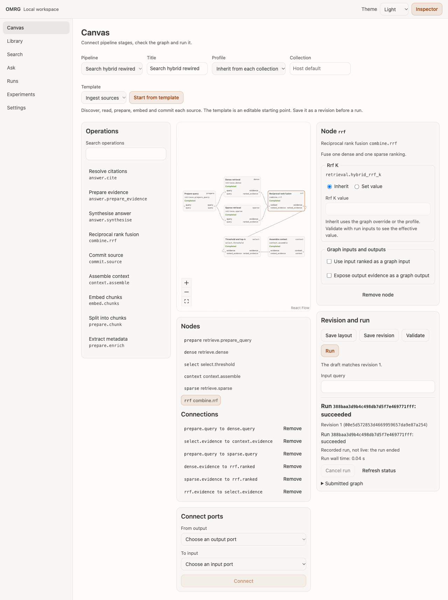

# Web workspace

`omrg web` starts a local browser workspace for OMRG. It serves the application and the `/v1` HTTP API from one loopback address. This guide tells you how to install it, start it, sign in, give it file access, follow long work, and stop it.

The web workspace is for one user on one machine. It does not accept remote connections.

Related guides:

- [Local workspace](workspace.md): the workspace folder, its records, retention and cleanup.
- [Pipeline graphs](pipelines.md): graph documents, operations and validation.
- [Notebooks](notebooks.md): the optional marimo notebook plugin and its trust model.
- `src/omrg/transports/api/README.md`: the API package, scopes and contract checks.
- `src/omrg/transports/api/openapi.yaml`: the full HTTP contract.

## Install the web extra

The web workspace needs FastAPI and Uvicorn. They are in the optional `web` extra. The base install does not include them.

In a checkout:

```bash
uv sync --extra web
```

From a package index:

```bash
pip install "omrg[web]"
```

The wheel contains the built application files. You do not need Node or npm to run `omrg web`.

Without the extra, only `omrg web` fails. It writes this message to stderr and exits with code 1:

<!-- web-missing-extra -->
```text
The web workspace needs the optional "web" extra. Install it with: pip install "omrg[web]"  (or, in a checkout: uv sync --extra web)
```

`import omrg`, `omrg --help`, the MCP server and the other `omrg` commands work without the extra.

## Start the server

```bash
omrg web --root ~/papers
```

The command writes a link to stderr. It writes nothing to stdout. Open the link in your browser:

```text
OMRG web workspace. Open this link in your browser (it works once):
http://127.0.0.1:<port>/#bootstrap=<secret>
Press Ctrl+C to stop.
```

### Options

<!-- web-options -->
| Option | Default | Use |
|---|---|---|
| `--workspace PATH` | `~/.omrg/workspace` | Directory for application records, run artefacts and uploads. |
| `--port N` | `0` (a free port) | TCP port to listen on. |
| `--host ADDR` | `127.0.0.1` | Loopback address only: `127.0.0.1`, `::1` or `localhost`. |
| `--root DIR` | none | Approve a directory for file access. Repeat the option for more directories. |
| `--experiment-root DIR` | none | Approve a directory below which you can register experiment workspaces. Repeat the option for more directories. |
<!-- /web-options -->

Rules for the options:

- A non-loopback address, for example `0.0.0.0` or a LAN address, stops the command with exit code 2.
- A `--root` or `--experiment-root` that is missing, or that is not a directory, stops the command with exit code 2.
- A busy `--port` stops the command with exit code 1.
- The server runs as one process. Automatic reload is off.

### One server for each workspace

At startup the server takes a lock on the workspace. A second `omrg web` with the same `--workspace` stops with this message on stderr and exit code 1:

```text
Another OMRG web server is using the workspace <path>. Stop it, or start this one with a different --workspace.
```

`GET /v1/session` returns the workspace path that the server uses, in the `workspace` field. The Settings view shows it.

## Sign in

The browser uses a session. A notebook or a script uses a bearer credential.

### Browser session

1. The launch link carries a one-time secret in its `#bootstrap=` fragment. The browser does not send a fragment to the server, so the secret stays out of the access log.
2. The page reads the fragment, removes it from the address bar, and sends it to `POST /v1/session`.
3. The server sets the cookie `omrg_session_<port>`. The cookie is HttpOnly and SameSite=Strict.

The link works once. After 20 wrong guesses, the secret stops working. To get a new link, restart `omrg web`.

The session holds every scope. A `POST`, `PUT`, `PATCH` or `DELETE` request with the cookie must also carry the application `Origin`.

### Bearer credentials for notebooks and scripts

A browser session issues bearer credentials:

```http
POST /v1/credentials
{"scopes": ["read", "graph", "run"], "label": "notebook"}
```

The response shows the token once, in the form `omrg_bt_<id>.<secret>`. Send it as `Authorization: Bearer <token>`. The server keeps only a digest of the secret.

- List credentials with `GET /v1/credentials`.
- Revoke one with `DELETE /v1/credentials/{credential_id}`. The revocation applies to the next request.
- All credentials stop when the server stops.

A bearer credential can hold only these scopes:

| Scope | Allows |
|---|---|
| `read` | Collections, search, answer, chunks, jobs, pipelines, runs and events. |
| `graph` | Create pipelines, save layouts and revisions, validate graphs. |
| `run` | Submit, cancel and retry graph runs. |

These scopes are session only. A bearer credential cannot hold them:

| Scope | Allows |
|---|---|
| `files` | Roots, uploads, ingestion jobs and codebase-map jobs. |
| `credentials` | Issue, list and revoke bearer credentials. |
| `manage` | Deletion, profile change, workspace cleanup and experiment registration. |
| `plugins` | Notebook plugin registration, recheck and editor launch. |

A credential that you issue with `experiment_context` is bound to that experiment. It runs graphs only in that experiment and cannot read or change the live library. See [Notebooks](notebooks.md).

### Request checks

The server checks every request before any route runs:

- The `Host` header must be a loopback name with the bound port. Otherwise the server returns 400.
- On `/v1` paths, a foreign `Origin` or a cross-site fetch gets 403.
- A credential in the query string gets 400. Put credentials in a header or the cookie.

`GET /v1/health` and `POST /v1/session` are the only public `/v1` operations.

## Give file access

The server reads files only below approved roots. It never accepts an arbitrary server path from the browser.

1. Start the server with one `--root` for each directory that it can read.
2. `GET /v1/roots` lists the approved roots and the managed upload root.
3. Give an absolute path inside an approved root to an ingestion job.

The server resolves each path, including symbolic links, before it reads it. A path that escapes its root gets 403 before any work starts. A source path in the index does not grant access to the original file. You can still inspect the stored chunks of that source.

### Upload files

Uploads go into the managed `uploads/` directory of the workspace.

1. Send `POST /v1/uploads/preflight` with `{"name": "report.pdf", "size": 1048576}`. Nothing is stored.
2. Send `POST /v1/uploads` with the raw file body. Put the percent-encoded file name in the `X-Upload-Name` header.
3. Ingest the upload by its path below the managed root.

Upload rules:

- The limit is 50 MiB for each file. The server also counts bytes while it receives them.
- The file name must be a plain name. Separators, control characters, hidden names and URL schemes get 400.
- The extension must be one that OMRG can ingest. Archives and other types get 415. A file over the limit gets 413.
- The server writes to a private partial file first. A failed or cancelled upload leaves no partial file.
- The response gives the upload `id`, `name`, `size` and `sha256`. It never gives the server path.

The initial release does not ingest from URLs.

## Jobs and graph runs

Long work is admitted as a job or a graph run. Both use one persisted run service with one consumer. At most 16 items can wait. A full queue gets 429.

| Work | Start | Response | Follow |
|---|---|---|---|
| Ingestion job | `POST /v1/ingestions` | 202 with a job | Poll `GET /v1/jobs/{jobId}` |
| Codebase-map job | `POST /v1/codebase-maps` | 202 with a job | Poll `GET /v1/jobs/{jobId}` |
| Graph run | `POST /v1/runs` | 202 with a run record | Poll `GET /v1/runs/{run_id}`, or read its events |

A job status is `queued`, `running`, `completed` or `failed`. A graph run status is `queued`, `running`, `cancelling`, `succeeded`, `failed`, `cancelled` or `interrupted`.

The server validates a graph run before it admits it. An invalid graph or input gets 422 with one issue for each problem, and no run starts. To stop a run, send `POST /v1/runs/{run_id}/cancel`. To run a failed, cancelled or interrupted run again, send `POST /v1/runs/{run_id}/retry`.

### Read run events

The server stores each event before a client sees it. Each event has a sequence number.

- **Polling.** `GET /v1/runs/{run_id}/events?after_sequence=N` returns the next page. Use `last_sequence` from the response as the next `after_sequence`. `complete` is true when the run has ended and no event is left.
- **Server-sent events.** `GET /v1/runs/{run_id}/events/stream` returns `text/event-stream`. After a reconnection, the browser sends `Last-Event-ID`, and the stream replays the later events. If you cannot set the header, use `?after=N`. The stream ends with `run.end`, or with `server.closing` when the server stops.

The browser removes duplicate events by sequence number. If the stream fails, the browser polls.

Closing a stream does not cancel the run. Only the cancel route cancels a run.

## Confirm destructive actions

Deletion, collection profile change and workspace cleanup use two requests:

1. Send a preview. It changes nothing. It returns the effect and a single-use token.
2. Send the same selector again with the token.

The token is bound to the action, the selector and the store state that the preview saw. It expires after 300 seconds. A missing token gets 428. A used, expired, altered or stale token gets 409, and nothing changes. Then make a new preview.

Some vector stores give only a process-local validity token. Then the preview says so in `confirmation.validity` and `confirmation.warning`: a change from another process can go undetected.

A confirmed profile change applies to new queries. Existing chunks stay as they are until you ingest again.

| Action | Preview | Confirm |
|---|---|---|
| Delete documents or a collection | `DELETE /v1/collections/{collection}/documents` with `dry_run: true` | The same request with `confirmation_token` |
| Change a collection profile | `PATCH /v1/collections/{collection}/profile` with `confirm: false` | The same request with `confirm: true` and `confirmation_token` |
| Clean up old run records | `POST /v1/workspace/cleanup/preview` | `POST /v1/workspace/cleanup` with the token |

Cleanup removes run records and run artefacts only. It never removes vector data, source files, uploads, notebooks or experiment outputs. See [Clean up old runs](workspace.md#clean-up-old-runs).

## Errors never return HTML

Every `/v1` error uses the JSON envelope `{"status": "error", "message": "..."}`. Some errors add `error_type` (`validation`, `retrieval` or `internal`) or `issues`.

- An unknown `/v1` path gets 404 with the envelope. The application page never answers a `/v1` path.
- An unexpected server error gets 500 with the message `Internal server error.` and no detail.
- Messages never contain stack traces or credential values. The server log removes credentials and configured provider secrets.

Paths outside `/v1` belong to the application. A missing asset file gets a plain 404. When the application files are not built, `/` returns a message that names `npm ci && npm run build`. The API still works.

## Stop the server

Press Ctrl+C in the terminal that runs `omrg web`. The server then:

1. stops new admission and ends open event streams with `server.closing`,
2. cancels queued work,
3. asks active runs to stop at a safe point and waits for active writes to finish,
4. stops notebook editors that it started,
5. closes the experiment engines and the Engine.

Closing the browser does not stop the server or cancel runs.

If the process stops without this sequence, for example after a crash, unfinished runs show `interrupted` at the next start. The server does not retry them. Check source completeness before you run the work again.

## Screens

The application has seven views. Use the navigation on the left to open a view. The theme control at the top selects System, Light or Dark.

The screenshots below show an offline server with synthetic Markdown sources, one of them Arabic prose with English identifiers. The Canvas shows the Search template after a rewiring: the rerank node is removed and a sparse branch joins the dense branch at a rank-fusion node. Each node shows the state from the finished run.



| View | What you can do | Light | Dark |
|---|---|---|---|
| Canvas | Start from a template, add operations, connect ports, save a revision, validate, run and cancel. | [image](images/web-workspace/canvas-light-1280.png) | [image](images/web-workspace/canvas-dark-1280.png) |
| Runs | Read the admitted snapshot, replay events, inspect each node and open stored evidence. | [image](images/web-workspace/runs-detail-light-1280.png) | [image](images/web-workspace/runs-detail-dark-1280.png) |
| Runs evidence | Read ranked rows with their score kind and open the full stored chunk. | [image](images/web-workspace/runs-evidence-light-1280.png) | [image](images/web-workspace/runs-evidence-dark-1280.png) |
| Library | List sources, upload and ingest files, preview and confirm deletion or a profile change. | [image](images/web-workspace/library-light-1280.png) | [image](images/web-workspace/library-dark-1280.png) |
| Search | Search a collection and open a stored chunk with its neighbours. | [image](images/web-workspace/search-light-1280.png) | [image](images/web-workspace/search-dark-1280.png) |
| Ask | Ask a question and check the citations and the evidence given to the model. | [image](images/web-workspace/ask-light-1280.png) | [image](images/web-workspace/ask-dark-1280.png) |
| Experiments | Register an experiment workspace, issue a bound credential and see experiment runs. | [image](images/web-workspace/experiments-light-1280.png) | [image](images/web-workspace/experiments-dark-1280.png) |
| Settings | Read the workspace path, runtime capabilities and approved folders. Register a notebook plugin. | [image](images/web-workspace/settings-light-1280.png) | [image](images/web-workspace/settings-dark-1280.png) |

On narrow screens the views use one column. The navigation moves to the top and scrolls sideways.

| Width | Canvas | Library | Runs |
|---|---|---|---|
| 768 px | [image](images/web-workspace/canvas-light-768.png) | [image](images/web-workspace/library-light-768.png) | [image](images/web-workspace/runs-light-768.png) |
| 390 px | [image](images/web-workspace/canvas-light-390.png) | [image](images/web-workspace/library-light-390.png) | [image](images/web-workspace/runs-light-390.png) |

Keyboard use on the Canvas:

1. Press Tab to move through the toolbar, the operation catalogue, the connections, the nodes and the controls.
2. On a node, press Enter to select it. Use the arrow keys to move it. Press Delete to remove it.
3. Use the Nodes and Connections lists and the Connect ports form to edit the graph without a pointer.

A focused node or connection has a visible outline: [image](images/web-workspace/canvas-focus-light-1280.png).

Image files: `docs/guides/images/web-workspace/canvas-light-1280.png`, `docs/guides/images/web-workspace/canvas-dark-1280.png`, `docs/guides/images/web-workspace/canvas-focus-light-1280.png`, `docs/guides/images/web-workspace/canvas-light-768.png`, `docs/guides/images/web-workspace/canvas-light-390.png`, `docs/guides/images/web-workspace/runs-detail-light-1280.png`, `docs/guides/images/web-workspace/runs-detail-dark-1280.png`, `docs/guides/images/web-workspace/runs-evidence-light-1280.png`, `docs/guides/images/web-workspace/runs-evidence-dark-1280.png`, `docs/guides/images/web-workspace/runs-light-768.png`, `docs/guides/images/web-workspace/runs-light-390.png`, `docs/guides/images/web-workspace/library-light-1280.png`, `docs/guides/images/web-workspace/library-dark-1280.png`, `docs/guides/images/web-workspace/library-light-768.png`, `docs/guides/images/web-workspace/library-light-390.png`, `docs/guides/images/web-workspace/search-light-1280.png`, `docs/guides/images/web-workspace/search-dark-1280.png`, `docs/guides/images/web-workspace/ask-light-1280.png`, `docs/guides/images/web-workspace/ask-dark-1280.png`, `docs/guides/images/web-workspace/experiments-light-1280.png`, `docs/guides/images/web-workspace/experiments-dark-1280.png`, `docs/guides/images/web-workspace/settings-light-1280.png`, `docs/guides/images/web-workspace/settings-dark-1280.png`. Third-party notices for the bundled application are in `web/THIRD_PARTY_NOTICES.md`.

## Optional parts

| Part | Needed for | Install |
|---|---|---|
| `web` extra | `omrg web` | `uv sync --extra web` or `pip install "omrg[web]"` |
| Experiment roots | Experiment workspaces and notebook runs | `omrg web --experiment-root DIR` |
| marimo | The notebook editor | Outside OMRG. See [Notebooks](notebooks.md). |

The workspace works without marimo. The Experiments view then shows how to install and register it.
