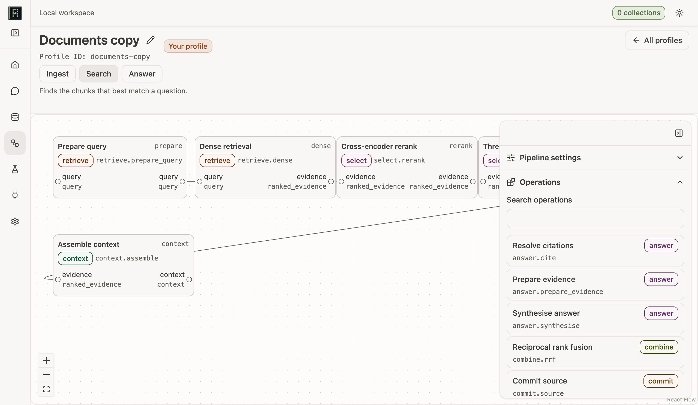
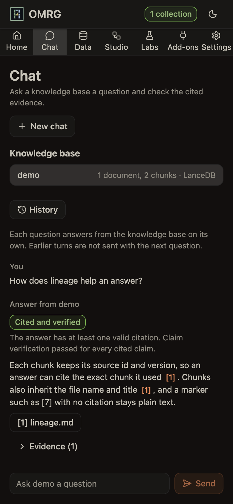
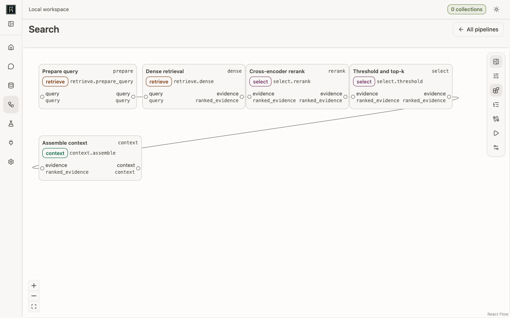
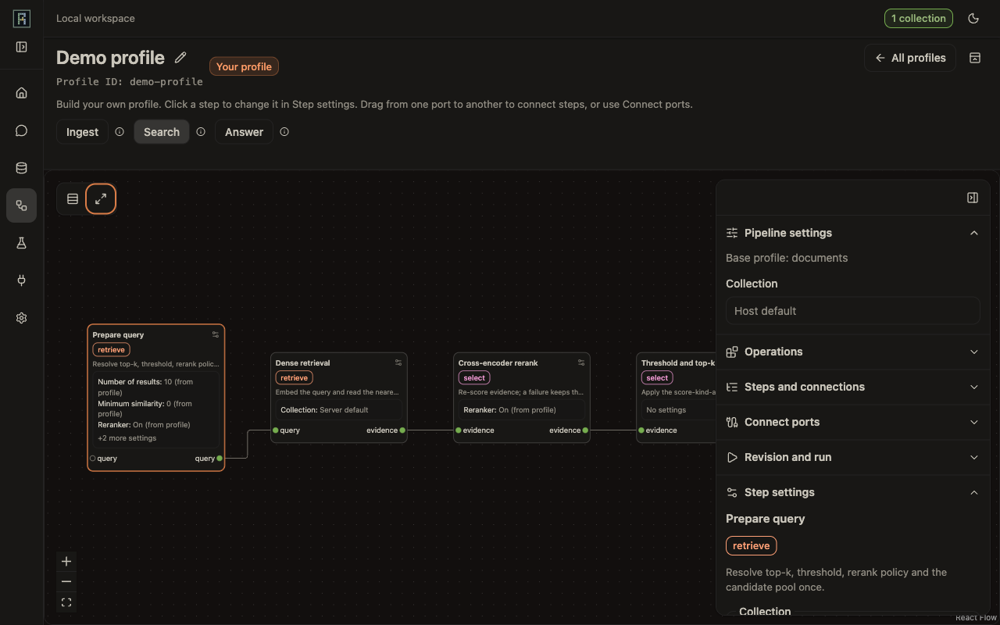
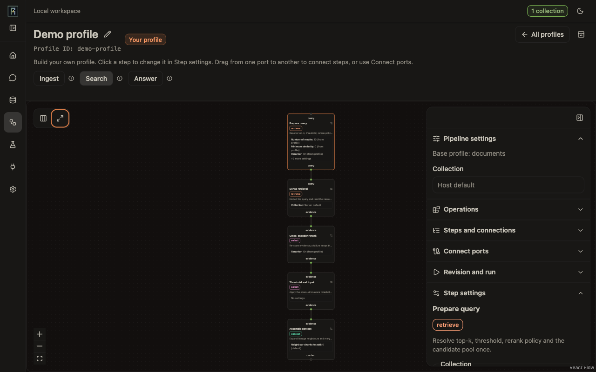
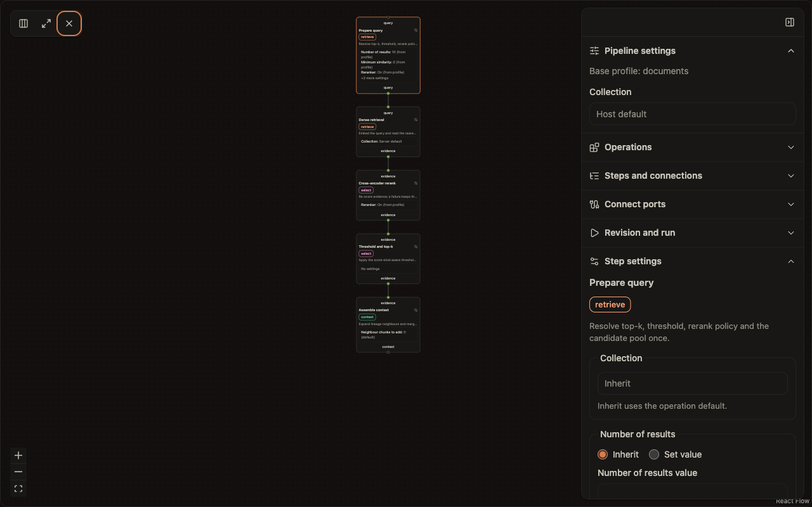

# Web workspace

`omrg web` starts a local browser workspace for OMRG. It serves the application and the `/v1` HTTP API from one loopback address. This guide tells you how to install it, start it, sign in, give it file access, follow long work, and stop it.

The web workspace is for one user on one machine. It does not accept remote connections.

Related guides:

- [Local workspace](workspace.md): the workspace folder, its records, retention and cleanup.
- [Pipeline graphs](pipelines.md): graph documents, operations and validation.
- [Notebooks](notebooks.md): the optional marimo notebook plugin and its trust model.
- `src/omrg/transports/api/README.md`: the API package, scopes and contract checks.
- `src/omrg/transports/api/openapi.yaml`: the full HTTP contract.

## Install the web extra

The web workspace needs FastAPI and Uvicorn. They are in the optional `web` extra. The base install does not include them.

In a checkout:

```bash
uv sync --extra web
```

From a package index:

```bash
pip install "omrg[web]"
```

The wheel contains the built application files. You do not need Node or npm to run `omrg web`.

Without the extra, only `omrg web` fails. It writes this message to stderr and exits with code 1:

<!-- web-missing-extra -->
```text
The web workspace needs the optional "web" extra. Install it with: pip install "omrg[web]"  (or, in a checkout: uv sync --extra web)
```

`import omrg`, `omrg --help`, the MCP server and the other `omrg` commands work without the extra.

## Start the server

```bash
omrg web --root ~/papers
```

The command writes a link to stderr. It writes nothing to stdout. Open the link in your browser:

```text
OMRG web workspace. Open this link in your browser (it works once):
http://127.0.0.1:<port>/#bootstrap=<secret>
Press Ctrl+C to stop.
```

### Options

<!-- web-options -->
| Option | Default | Use |
|---|---|---|
| `--workspace PATH` | `~/.omrg/workspace` | Directory for application records, run artefacts and uploads. |
| `--port N` | the saved port, else `8765` | TCP port to listen on. `0` picks a free port. |
| `--host ADDR` | `127.0.0.1` | Loopback address only: `127.0.0.1`, `::1` or `localhost`. |
| `--root DIR` | none | Approve a directory for file access. Repeat the option for more directories. |
| `--experiment-root DIR` | none | Approve a directory below which you can register experiment workspaces. Repeat the option for more directories. |
| `--allow-origin ORIGIN` | none | Approve one extra loopback browser origin for this run, for example `http://name.orca.localhost:57977`. Repeat the option for more origins. |
| `--max-upload-mib MIB` | saved limit, else `50` | Per-file upload limit in whole MiB, 1 to 2048. Also read from `WEB_MAX_UPLOAD_MIB`. It locks the limit in Settings for this run. |
<!-- /web-options -->

Rules for the options:

- A non-loopback address, for example `0.0.0.0` or a LAN address, stops the command with exit code 2.
- A `--root` or `--experiment-root` that is missing, or that is not a directory, stops the command with exit code 2.
- An `--allow-origin` value that is not an exact `http` or `https` loopback origin stops the command with exit code 2 before it binds a port. The message names the rule that failed.
- A busy port (from `--port`, the saved port or the default) stops the command with exit code 1. The message names the port, `--port <n>` and Settings > MCP.
- The server runs as one process. Automatic reload is off.

### One server for each workspace

At startup the server takes a lock on the workspace. A second `omrg web` with the same `--workspace` stops with this message on stderr and exit code 1:

```text
Another OMRG web server is using the workspace <path>. Stop it, or start this one with a different --workspace.
```

`GET /v1/session` returns the workspace path that the server uses, in the `workspace` field. The Workspace section of Settings shows it.

## Keep the app running

`omrg web` stops when you close its terminal window. On a Mac, a login item keeps the app running and starts it at every login. The commands are in the [CLI reference](cli-reference.md).

```bash
omrg web install    # write the login item and start it
omrg web open       # open the app in your browser, signed in
```

A login item has no terminal, so it signs you in in a different way:

- **The link file.** The server writes the sign-in link to `<workspace>/launch-link`, as one line. It writes the link to no terminal and no log. `omrg web open` reads the file and opens the link in your browser.
- **Who can read it.** Only your macOS user can read the file (mode `0600`). Any program that runs as you can read it and sign in, including AI agents on your Mac. This is the same trust level as `workspace.db`, which these programs can already read.
- **The link renews.** The server writes a new link after each sign-in and after 20 wrong guesses. It removes the file when it stops, also after a stop signal.
- **A stop signal restarts the app.** The login item starts again after a stop signal, because launchd treats it as a crash. Turn off in the power panel unloads it until the next login or `omrg web start`. Run `omrg web uninstall` to remove it for good.
- **A restart keeps the open tab signed in.** Browser sessions live in memory only, so a restart ends them. The page then signs in again by itself with the workspace sign-in secret. See [Browser session](#browser-session). Run `omrg web open` only to open a new tab, or after a restart that changes the port.
- **The access log is off.** The log files of the login item have no rotation, so the server writes only start-up and error lines.
- **Settings come from `omrg.jsonc`.** The login item reads `omrg.jsonc` in the user config folder (`~/.config/omrg/omrg.jsonc` by default). It also reads `~/.omrg/.env` when that file exists. That `.env` is optional and overrides the file. A hand-run `omrg web` reads the `.env` file of the folder where you run it. Shell variables do not reach the login item. Run `omrg config init` to write a starter `omrg.jsonc`. The install command never copies or reads a `.env` file.

## Sign in

The browser uses a session. A notebook or a script uses a bearer credential.

### Browser session

Two secrets open a browser session. Both go to `POST /v1/session`.

**The workspace sign-in secret.** This secret keeps the page signed in across restarts.

1. On its first start, the server writes a new secret to `<workspace>/.auth-token`. Only your macOS user can read the file (mode `0600`). Every later start with the same workspace uses the same secret.
2. The server puts the secret into the page that it serves, in a `<meta name="omrg-page-secret">` tag. It does this only for a page load from its own address, or from an address that you approved with `--allow-origin`. A request with a foreign `Host` gets 400. A request with a foreign `Origin`, or a cross-site fetch, gets the page without the secret.
3. The page reads the secret, removes the tag and sends the secret to `POST /v1/session`.
4. When a request gets 401, for example after a restart, the page sends the secret again once and repeats the request once.

The server never writes the secret to a log, an API response, an error message or a URL. If the file has a looser mode than `0600`, the server logs a warning and sets the mode to `0600`. To change the secret, stop the server, delete `<workspace>/.auth-token` and start the server again. Then reload each open tab.

Any program that runs as you can read the file and sign in, including AI agents on your Mac. This is the same trust level as `workspace.db` and the login-item link file. See [ADR-088](../adr/088-persistent-workspace-sign-in-secret.md).

**The one-time launch link.** The link that `omrg web` prints and `omrg web open` opens still works.

1. The launch link carries a one-time secret in its `#bootstrap=` fragment. The browser does not send a fragment to the server, so the secret stays out of the access log.
2. The page reads the fragment, removes it from the address bar, and sends it to `POST /v1/session`. If the link was already used, the page uses the workspace secret instead.

The link works once. After 20 wrong guesses, the link stops working. Wrong guesses do not stop the workspace secret.

Both secrets give the same session. The server sets the cookie `omrg_session_<port>`. The cookie is HttpOnly and SameSite=Strict.

The session holds every scope. A `POST`, `PUT`, `PATCH` or `DELETE` request with the cookie must also carry the application `Origin`.

### Bearer credentials for notebooks and scripts

A browser session issues bearer credentials:

```http
POST /v1/credentials
{"scopes": ["read", "graph", "run"], "label": "notebook"}
```

The response shows the token once, in the form `omrg_bt_<id>.<secret>`. Send it as `Authorization: Bearer <token>`. The server keeps only a digest of the secret.

- List credentials with `GET /v1/credentials`.
- Revoke one with `DELETE /v1/credentials/{credential_id}`. The revocation applies to the next request.
- All credentials stop when the server stops.

A bearer credential can hold only these scopes:

| Scope | Allows |
|---|---|
| `read` | Collections, search, answer, chunks, jobs, pipelines, runs and events. |
| `graph` | Create pipelines, save layouts and revisions, validate graphs. |
| `run` | Submit, cancel and retry graph runs. |

These scopes are session only. A bearer credential cannot hold them:

| Scope | Allows |
|---|---|
| `files` | Roots, uploads, ingestion jobs and codebase-map jobs. |
| `credentials` | Issue, list and revoke bearer credentials. |
| `manage` | Deletion, profile change, workspace cleanup, experiment folders and registration, connection tests and the server log. |
| `plugins` | Notebook plugin registration, recheck and editor launch. |

A credential that you issue with `experiment_context` is bound to that experiment. It runs graphs only in that experiment and cannot read or change the live library. See [Notebooks](notebooks.md).

### Request checks

The server checks every request before any route runs:

- The `Host` header must be a loopback name with the bound port. Otherwise the server returns 400.
- On `/v1` paths, a foreign `Origin` or a cross-site fetch gets 403. An origin is not foreign when it is the server's own loopback address or one that you approved with `--allow-origin`.
- A credential in the query string gets 400. Put credentials in a header or the cookie.

`GET /v1/health` and `POST /v1/session` are the only public `/v1` operations.

#### Use an embedded preview

Some preview panes, for example the Orca browser preview, serve the workspace page from their own address. The server then refuses the sign-in with 403, and the page shows "The workspace session was not accepted".

1. Copy the origin from the address bar of the preview. It has the form `http://<name>.orca.localhost:<port>`.
2. Start the server with `omrg web --allow-origin <origin>`.
3. Open the link that the command prints, in the preview.

The option approves that one origin for this run only. The host must be `localhost`, a `.localhost` name, `127.0.0.1` or `[::1]`. A wildcard, a path or any other host stops the command. The option does not change the `Host` check or the cookie rules. The preview can change its port, or the number at the end of its host name, when it reopens. If the sign-in fails again with 403, copy the new origin and start the server again. You can repeat `--allow-origin` to approve several host names in one launch.

## Give file access

The server reads files only below approved roots. It never accepts an arbitrary server path from the browser.

1. Start the server with one `--root` for each directory that it can read.
2. `GET /v1/roots` lists the approved roots and the managed upload root.
3. Give an absolute path inside an approved root to an ingestion job.

The server resolves each path, including symbolic links, before it reads it. A path that escapes its root gets 403 before any work starts. A source path in the index does not grant access to the original file. You can still inspect the stored chunks of that source.

### Upload files

Uploads go into the managed `uploads/` directory of the workspace.

1. Send `POST /v1/uploads/preflight` with `{"name": "report.pdf", "size": 1048576}`. Nothing is stored.
2. Send `POST /v1/uploads` with the raw file body. Put the percent-encoded file name in the `X-Upload-Name` header.
3. Ingest the upload by its path below the managed root.

Upload rules:

- The limit is 50 MiB for each file by default. The server also counts bytes while it receives them. To change the limit, see [Set the upload limit](#set-the-upload-limit).
- The file name must be a plain name. Separators, control characters, hidden names and URL schemes get 400.
- The extension must be one that OMRG can ingest. Archives and other types get 415. A file over the limit gets 413.
- The server writes to a private partial file first. A failed or cancelled upload leaves no partial file.
- The response gives the upload `id`, `name`, `size` and `sha256`. It never gives the server path.

The initial release does not ingest from URLs.

### Set the upload limit

The per-file limit is a workspace setting, from 1 to 2048 MiB. The server uses the first value in this order:

1. `omrg web --max-upload-mib <n>`.
2. `WEB_MAX_UPLOAD_MIB` in the environment or `.env`.
3. The value saved in Settings > Workspace.
4. 50 MiB.

`GET /v1/settings/upload-limit` (`read`) returns the limit in force:

```json
{"status": "ok", "max_bytes": 52428800, "source": "default", "saved_mib": null,
 "default_mib": 50, "min_mib": 1, "max_mib": 2048}
```

`source` is `launch`, `config-file` or `default`. To change the limit, send `PUT /v1/settings/upload-limit` with `{"max_mib": 200}`. To return to the default, send `{"max_mib": null}`. This request needs the browser session.

- The server saves the value first. Then it applies the value to new uploads at once, with no restart.
- An upload in progress keeps the limit it started with.
- A value that is not a whole number from 1 to 2048, or an extra field, gets 422. Nothing changes.
- When a launch option set the limit, the request gets 409 and nothing changes. Remove the option and restart to change the limit in Settings.

## Jobs and graph runs

Long work is admitted as a job or a graph run. Both use one persisted run service with one consumer. At most 16 items can wait. A full queue gets 429.

| Work | Start | Response | Follow |
|---|---|---|---|
| Ingestion job | `POST /v1/ingestions` | 202 with a job | Poll `GET /v1/jobs/{jobId}` |
| Codebase-map job | `POST /v1/codebase-maps` | 202 with a job | Poll `GET /v1/jobs/{jobId}` |
| Graph run | `POST /v1/runs` | 202 with a run record | Poll `GET /v1/runs/{run_id}`, or read its events |

A job status is `queued`, `running`, `completed` or `failed`. A graph run status is `queued`, `running`, `cancelling`, `succeeded`, `failed`, `cancelled` or `interrupted`.

The server validates a graph run before it admits it. An invalid graph or input gets 422 with one issue for each problem, and no run starts. To stop a run, send `POST /v1/runs/{run_id}/cancel`. To run a failed, cancelled or interrupted run again, send `POST /v1/runs/{run_id}/retry`.

### Read run events

The server stores each event before a client sees it. Each event has a sequence number.

- **Polling.** `GET /v1/runs/{run_id}/events?after_sequence=N` returns the next page. Use `last_sequence` from the response as the next `after_sequence`. `complete` is true when the run has ended and no event is left.
- **Server-sent events.** `GET /v1/runs/{run_id}/events/stream` returns `text/event-stream`. After a reconnection, the browser sends `Last-Event-ID`, and the stream replays the later events. If you cannot set the header, use `?after=N`. The stream ends with `run.end`, or with `server.closing` when the server stops.

The browser removes duplicate events by sequence number. If the stream fails, the browser polls.

Closing a stream does not cancel the run. Only the cancel route cancels a run.

### Read full run output

An event, status or node summary larger than 16 KiB is cut. The server keeps the full value, with credentials and raw vectors removed, in a private artefact. The cut summary has `truncated: true` and `artefact_ref: "<run_id>/<name>.json"`.

1. Take `<name>` from `artefact_ref`. Remove the run id and `.json`.
2. Send `GET /v1/runs/{run_id}/artefacts/{name}`.
3. Read the full value in `value`.

The route has the same access rule as `GET /v1/runs/{run_id}`. A run that you cannot read gets 404 `Unknown run.`. An unknown name gets 404 `This run has no such output.`. A name that is not one plain path segment gets 400, and the server reads no file.

## Confirm destructive actions

Deletion, collection profile change and workspace cleanup use two requests:

1. Send a preview. It changes nothing. It returns the effect and a single-use token.
2. Send the same selector again with the token.

The token is bound to the action, the selector and the store state that the preview saw. It expires after 300 seconds. A missing token gets 428. A used, expired, altered or stale token gets 409, and nothing changes. Then make a new preview.

Some vector stores give only a process-local validity token. Then the preview says so in `confirmation.validity` and `confirmation.warning`: a change from another process can go undetected.

A confirmed profile change applies to new queries. Existing chunks stay as they are until you ingest again.

| Action | Preview | Confirm |
|---|---|---|
| Delete documents or a collection | `DELETE /v1/collections/{collection}/documents` with `dry_run: true` | The same request with `confirmation_token` |
| Change a collection profile | `PATCH /v1/collections/{collection}/profile` with `confirm: false` | The same request with `confirm: true` and `confirmation_token` |
| Clean up old run records | `POST /v1/workspace/cleanup/preview` | `POST /v1/workspace/cleanup` with the token |

Cleanup removes run records and run artefacts only. It never removes vector data, source files, uploads, notebooks or experiment outputs. See [Clean up old runs](workspace.md#clean-up-old-runs).

Changing a display name needs the browser session but no preview and no token. It changes only a label, loses no data and can be undone by saving the old value.

## Errors never return HTML

Every `/v1` error uses the JSON envelope `{"status": "error", "message": "..."}`. Some errors add `error_type` (`validation`, `retrieval` or `internal`) or `issues`.

- An unknown `/v1` path gets 404 with the envelope. The application page never answers a `/v1` path.
- An unexpected server error gets 500 with the message `Internal server error.` and no detail.
- Messages never contain stack traces or credential values. The server log removes credentials and configured provider secrets.

Paths outside `/v1` belong to the application. A missing asset file gets a plain 404. When the application files are not built, `/` returns a message that names `npm ci && npm run build`. The API still works.

## MCP over HTTP

The server can serve MCP at `/mcp`. It is off by default. Turn it on with `PUT /v1/mcp` (Settings > MCP). `POST /v1/mcp/token` creates or rotates the one token. `DELETE /v1/mcp/token` revokes it. `PUT /v1/settings/web-port` saves the port for the next launch. These changes need the browser session. Client set-up and the request checks: [MCP tools](mcp-tools.md#connect-a-client).

## Integrations, provider settings and the server log

`GET /v1/integrations`, `GET /v1/logs` and `GET /v1/logs/stream` show the state of the running server. They change no setting and install no package. The provider and Chat routes below can change settings. Each change needs the browser session.

| Route | Scope | What it does |
|---|---|---|
| `GET /v1/integrations` | `read` | One entry for each installable extra and for Magika. `availability` is `available`, `not-installed` or `unknown` (a probe failed). Each entry has copy-ready `install_command` and `pip_command` values. |
| `GET /v1/connections` | `read` | `config_dir`, `user_config_dir` (the user config folder, with `~` for home), `keychain` (`available` or `unavailable`) and one entry for each registered LLM provider. Each entry has `fields[]` (`id`, `label`, `kind`, `value` for addresses, `source` (`env`, `dotenv`, `config-file`, `keychain`, `key-file`, `default` or `none`), `locked`, `lock_reason`, `required` (false for a key the provider can run without), `set`, `last4`, `state`), `read_only[]`, `roles`, `installed` and `install_hint`. A key is never returned. `last4` is set only when the key has 16 or more characters. |
| `PUT /v1/connections/{provider}` | `manage` | Body `{fields: {<id>: url or null}}`. Saves or clears addresses. Returns 400 for a bad address, 404 for an unknown provider or field, and 409 for a locked field (from the environment, `.env` or `omrg.jsonc`). |
| `PUT /v1/connections/{provider}/key` | `credentials` | Body `{api_key}`, 8 to 512 printable characters with no spaces. Saves the key to the system keychain. Returns 409 when the key comes from the environment, `.env` or `omrg.jsonc`, or when no keychain exists. A key file does not cause a 409. |
| `DELETE /v1/connections/{provider}/key` | `credentials` | Removes the key from the system keychain. |
| `POST /v1/connections/{provider}/test` | `manage` | Optional body `{fields: {<id>: value}}`. Tests typed values and saves nothing. Returns `{reachable, reason}` after one request with a 5-second timeout. `reason` is `refused`, `timeout`, `unauthorised`, `http-<status>` or `not-configured`. No response body or error text is returned. |
| `GET /v1/llamacpp/server` | `read` | `{state, reason, running_with, saved}`. `state` is `stopped`, `starting`, `running` or `failed`. `reason` is one of `binary-invalid`, `model-invalid`, `not-loopback`, `port-in-use`, `exited`, `timeout`, `not-configured`. `saved` holds `binary`, `model` and `context_window`, each with `source` and `locked`. No output of the server is returned. |
| `PUT /v1/llamacpp/server` | `manage`; `credentials` when the body sets `binary` or `model` | Saves the program path, model, context window and idle sleep. Returns 400 for a rule failure and 409 for a locked field. |
| `POST /v1/llamacpp/server/start` | `manage` | Starts the server that omrg owns. Waits for `GET /health` up to 180 seconds. |
| `POST /v1/llamacpp/server/stop` | `manage` | SIGTERM to the owned process group, 10 seconds, then SIGKILL. |
| `POST /v1/llamacpp/server/restart` | `manage` | Stop, then start with the saved values. |
| `POST /v1/connections/{provider}/models` | `manage` | Optional body `{fields: {<id>: value}}`. Returns `{reachable, reason, models[], truncated}`. Reads at most 8 MiB and returns at most 1,000 names. |
| `GET /v1/settings/chat` | `read` | `{provider, model, source, locked, lock_reason, enabled, ready, reason}`. |
| `PUT /v1/settings/chat` | `manage` | Body `{provider, model}`, or `null` to clear. Saves the Chat model. Returns 400 for a bad choice and 409 when the choice is locked. |
| `POST /v1/settings/chat/test` | `manage` | Optional body `{provider, model}`. Sends one short prompt and returns `{ok, reason, elapsed_ms}`. No model text is returned. |
| `GET /v1/logs?after=<seq>` | `manage` | The buffered log records after a sequence. |
| `GET /v1/logs/stream` | `manage` | The same records as server-sent events, with replay after `Last-Event-ID` or `?after=`. The stream ends with `server.closing`. |

Key routes need the `credentials` scope and the browser session. A bearer credential never passes. The `manage` provider routes need the browser session as well.

### Provider settings

Settings > Providers shows one card for each registered LLM provider. Today these are Ollama, llama.cpp, OpenRouter, OpenAI-compatible and Anthropic. The last two serve Chat answers only. A new provider in the registry gets a card with no web change. Editable fields are the Ollama address, the llama.cpp chat address, the OpenRouter key, the OpenAI-compatible address and key, and the Anthropic key. The OpenAI-compatible key is optional, because LM Studio and vLLM need none. Chat is ready without it. The Anthropic key is required. Without it Chat reports `not-configured`. A card whose package is missing shows its install command, for example `uv sync --extra anthropic`. The OpenAI-compatible address can be on this machine or remote. The key goes only to that address, and the card states that text leaves this machine when the address is not on this machine. Embedding addresses and embedding models are shown but cannot be edited here.

Each value comes from one source. The server uses the first source it finds:

1. The process environment, then `.env`. The field shows "Set from environment (read-only here)" and is locked. A save returns 409 and names the variable to remove.
2. `omrg.jsonc` in the user config folder. The field shows "Set from config file (read-only here)" and is locked. A save returns 409. The lock text reads "Set in ~/.config/omrg/omrg.jsonc. Edit that file and restart to change it." (the path comes from `user_config_dir`).
3. A value saved in Settings. Addresses are stored in the workspace database. Keys are stored in the system keychain.
4. A key file `secrets/<provider>.key` (keys only). The field shows "Set from key file (read-only here). Saving a key in the keychain overrides it." It is not locked: a saved key overrides it, and removing the saved key falls back to the file.
5. The default.

The user config folder is read-only. The app never writes to it, and the page cannot edit it. The CLI and the stdio MCP server read it too, but they do not see saved web values. The files are plaintext, so on a desktop the keychain stays the advice. Both files are read at launch, so a change needs a restart. Details and examples: [Configuration](configuration.md#user-config-folder).

A saved value applies at once to new requests in the running `omrg web` process. You do not restart the server. A call that already started finishes with the old value. The Engine refuses a change that would alter an embedding field. The Ollama address is locked while embeddings use Ollama ("embeddings use it").

#### Keychain

The server saves a key with the `keyring` package. The service name is `omrg` and the user name is the provider name, for example `openrouter`. All workspaces of one login share that entry. The database stores only the time of the save. The app never writes a key to `.env`, to the database or to a file. No response contains more than the last four characters of a key, and no log line contains a key.

The server uses the macOS Keychain, Windows Credential Manager or the Secret Service on a Linux desktop (GNOME Keyring, or KWallet through Secret Service). It does not use a plaintext backend.

If `omrg.jsonc` holds a `keychain://` reference and the keychain entry is gone, the card shows that the saved key is missing. If the keychain cannot be read, the card shows that the keychain is unreadable. In both cases the provider has no key.

#### No keychain

In a container, in WSL without a keyring or on a headless server, no usable keychain exists. A key save returns 409 and the server stores nothing. The card says that no system keychain was found and names the variable to set, for example `OPENROUTER_API_KEY`. Set the variable in the environment or in `.env`, then start `omrg web`. Addresses still save in `omrg.jsonc`.

#### Remove keys from the keychain

Remove the key in Settings > Providers with Remove key. To remove an entry by hand, for example after you uninstall OMRG, use the steps for your system. Use the service name `omrg` and the provider name as the account.

1. macOS: open Keychain Access, search for `omrg`, select the entry and delete it. The command line also works: `security delete-generic-password -s omrg -a openrouter`.
2. Windows: open Credential Manager, choose Windows Credentials, find the entry for `omrg`, expand it and select Remove.
3. Linux: run `secret-tool clear service omrg username openrouter`.

#### What other processes do not see

Saved addresses and saved keys apply to `omrg web` and its MCP endpoint only. The stdio MCP server, the CLI and experiment contexts do not read them. The saved Chat model and the saved claim check judge go in `omrg.jsonc`. The stdio MCP server and the CLI read them at their next launch. They read the environment, `.env` and the user config folder. To give those processes a value, put it in `.env` or in `omrg.jsonc`.

### Local llama.cpp server

The llama.cpp card has a Local server panel. It shows the state, the program path, the model, the context window, the idle sleep (default 300 seconds; 0 turns it off), and the buttons Start, Stop and Restart. The panel says: "omrg starts and stops only this server. It never touches a server you started yourself." After a save the server keeps running and the panel says "Restart to apply" when the saved values differ. The program path and model need a browser session with the `credentials` scope. The window and the buttons need `manage`. A bearer token never works. The server output goes to `llamacpp-server.log` in the workspace folder and is not shown. The Ollama card has a "Context window (tokens)" number field. Guardrails and limits: [Configuration](configuration.md#local-llamacpp-server).

### Chat model

Settings > Chat sets the provider and model that Chat uses. The same choice answers MCP clients of this web server that cannot supply their own model. Metadata extraction keeps its own model. The choice locks when `ANSWER__PROVIDER` or `ANSWER__MODEL` is set in the environment or `.env`. A cloud provider sends questions and retrieved passages off this machine. The Chat section says so. List models and Test run only when you press them. When no model is ready, Chat shows one line with a link to Settings > Chat and disables Send.

The server keeps the last 1,000 log records in memory and writes no log file. The filter that removes provider keys and credentials runs before a record is stored.

`POST /v1/experiment-folders` (scope `manage`) creates a directory below an approved experiment root. `GET /v1/experiments` returns the folder tree of each root in `folders`.

### Claim check judge

Settings > Chat has a "Claim check judge" block below the Chat choice. The judge checks each cited claim in an answer against its cited passage ([ADR-059](../adr/059-claim-verification-stage.md)). The block shows the judge provider and the judge model, each with its source. An alias shows with the provider it resolves to, for example "cloud (OpenRouter)".

The judge model is empty by default. The default provider, OpenRouter, has no default model. The block then shows "Not set" and says: "Claim checks are skipped until you set a judge model."

To set the judge:

1. Open Settings > Chat.
2. In the "Claim check judge" block, press Edit.
3. Select the provider.
4. Type the model name, or press List models and pick one.
5. Optional: press Test to check the choice. Test saves nothing.
6. Press Save. Save stays disabled while the model name is empty.

The page writes `answer.verify_provider` and `answer.verify_model` together in `omrg.jsonc`. It writes a registry name only, never the alias `cloud` or `local`. The new judge applies at once in `omrg web`, with no restart. An answer that is running keeps its old judge. Press Remove to clear both keys and return to the default. Remove shows only when the source is `config-file`. The stdio MCP server and the CLI read the same `omrg.jsonc` at their next launch.

The block locks when `ANSWER__VERIFY_PROVIDER` or `ANSWER__VERIFY_MODEL` is set in the environment or `.env`. A locked block names the variable and where it is set, and offers no Edit or Remove.

The block sets which judge runs. It does not turn claim checks on. The profile lever "Check claims" in Studio does that, per collection. The judge runs only for collections whose profile turns on "Check claims". A profile that sets its own judge overrides this choice.

A cloud judge sends each claim and its cited passages off this machine. The block says so when the selected provider is cloud.

`GET /v1/settings/judge` (read scope) returns the choice, its source and whether the judge is ready. It never contacts the provider. When the model in force is empty, it reports `ready: false` with the reason `no-model`. `PUT /v1/settings/judge` needs a browser session with the `manage` scope. It returns 400 for an empty model, an unknown provider or a body with one field only. It returns 409 when the choice is locked or the file revision is stale.

### Document reading

Settings > Document reading (`#/settings/document-reading`) sets how OMRG reads documents. It has one row for each of these nine keys:

| Row | Key | Control |
| --- | --- | --- |
| PDF reader | `pdf_reader` | A select. A reader that is not installed shows the reason and you cannot choose it. |
| OCR fallback | `ocr_fallback_enabled` | A switch. |
| Lowest text confidence | `ocr_fallback_min_confidence` | A number from 0 to 1. |
| OCR page fraction | `ocr_fallback_page_fraction` | A number from 0 to 1. |
| OCR routing unit | `ocr_routing_unit` | A select of `document` and `page`. |
| Primary engine | `ocr_engine_primary` | A select of the engines that the server finds. |
| Fallback engine | `ocr_engine_fallback` | A select of the engines that the server finds. |
| Maths routing | `ocr_maths_routing_enabled` | A switch. |
| Maths page fraction | `ocr_maths_page_fraction` | A number from 0 to 1. |

Each row shows the value in force, where it comes from and the default. To change a value:

1. Select Edit on the row.
2. Choose or type the new value.
3. Select Save.

Save writes the key to `omrg.jsonc`. It does not change the value in force. The changes apply after a restart of `omrg web`. Until the restart, the row shows the saved value and "Restart to apply". After the save, the restart dialog opens. Select "Restart now", or select Later and restart yourself.

Select "Use default" to remove the key from `omrg.jsonc`. The default then applies at the next launch. A blank engine name is refused. To use no fallback engine, set `OCR_ENGINE_FALLBACK=` in the environment or `.env`. The row is then locked and shows "None (no fallback)". A blank value in `omrg.jsonc` reads as not set, so the row shows "Not set".

These rules also apply:

- A key set in the environment or `.env` is read-only. The row names the variable to remove.
- An engine that is not provisioned shows the reason. You can still choose it, for example before you provision it.
- When `OCR_WORKER_COMMAND` is set, the Primary engine row says that the command replaces the primary engine.
- When `auto` or a missing reader resolves to another reader, the PDF reader row shows the reader in use.
- A Read document step in a pipeline can choose its own reader.

The nine keys are part of the index identity. After a restart, the next ingest can read existing files again. A failed save shows the server message. When `omrg.jsonc` changed on disk, select Reload to read the new values, then save again.

### Embedding model of a profile

A user profile can choose its own embedding provider and model (ADR-081). The embedding routes follow. Both `manage` routes need the browser session.

| Route | Scope | Body | Returns |
|---|---|---|---|
| `GET /v1/embedding-providers` | `read` | none | `providers` (`{name, available, reason}`; `reason` names the extra to install when `available` is false) and `server_default` (`{provider, model}`). No request goes to a provider. |
| `POST /v1/embedding-providers/{provider}/check` | `manage` | `{model}` | `{ok, dimensions, norm, reason}`. The server embeds the text `OMRG model check` with a throwaway embedder. A failed check is still HTTP 200 with `ok: false` and a plain-English `reason`. An unregistered provider gives 404. |
| `PUT /v1/profiles/{profile_id}/embedding` | `manage` | `{provider, model}`, or `{provider: null, model: null}` for the server default | `{profile}`. The server runs the same check first. |

"Check model" for llama.cpp first reads `GET {LLAMACPP_EMBED_URL}/models`. The model name must match a served model, because llama.cpp ignores the name in an embedding request. The check fails when the vector length is outside `EMBEDDING__NORM_TOLERANCE` while the norm guard is on. Credentials are removed from every `reason`.

`PUT /v1/profiles/{profile_id}/embedding` refuses in four cases:

| Status | When | Body |
|---|---|---|
| 400 | The profile is built in. The message is "Duplicate the profile to choose another model." | `message` |
| 404 | The profile or the provider is unknown. | `message` |
| 409 | A collection that follows the profile holds vectors made with another model. | `error_type: "embedding_locked"` and `collections: [{collection, provider, model, chunk_count}]`, first blocking collection first. `provider` and `model` are `null` when the model that made the vectors is not recorded. |
| 422 | The model check fails. The profile keeps its model. | `reason` |

A request for the model that the collections already hold is allowed.

Every item from `GET /v1/profiles` and `GET /v1/profiles/{profile_id}` has two more fields:

- `embedding`: `{provider, model, source, dimensions}`. `source` is `profile` or `server_default`. A built-in profile always shows the server default. `dimensions` is the vector size of the last passing check, or `null`.
- `embedding_lock`: `{locked, collections}`. `locked` is true while a collection that follows the profile holds vectors. `collections` has the same entries as the 409 body.

`PATCH /v1/collections/{collection}/profile` returns 409 with `error_type: "embedding_mismatch"` when the profile's model differs from the model that the collection's vectors were made with. The message names both models. The refusal applies to the preview and to the confirm step. The profile tag does not change. A collection with rows but no model stamp binds only to a profile that uses the server default.

## Stop the server

Press Ctrl+C in the terminal that runs `omrg web`. The server then:

1. stops new admission and ends open event streams with `server.closing`. An open MCP stream is closed after 5 seconds,
2. cancels queued work,
3. asks active runs to stop at a safe point and waits for active writes to finish,
4. stops notebook editors that it started,
5. closes the experiment engines and the Engine.

Closing the browser does not stop the server or cancel runs.

If the process stops without this sequence, for example after a crash, unfinished runs show `interrupted` at the next start. The server does not retry them. Check source completeness before you run the work again.

## Screens

The workspace has seven areas. Use the navigation on the left to open an area. The OMRG logo and name sit at the top of the navigation. Use the button next to them to collapse the navigation to a column of icons. In the collapsed column, the button sits under the logo. The browser remembers the choice. Under 768 px the navigation becomes one row of icons under the top bar. The top bar shows the collection count and one button that switches between Light and Dark. Choose System, Light or Dark in Settings.

Every area has its own address. Back and forward move between them. An address that the app does not know opens Home.

| Area | Address | What you can do |
|---|---|---|
| Home | `#/home` | See every project as a card with its title, profile, counts and database. Open a project. |
| Chat | `#/chat/<collection>` | Pick a knowledge base by its title and ask it a question. Read the answer, the passages it cites and the passages the model was given. Each question answers on its own. Chats are stored: see Chat history. |
| Knowledge Base | `#/knowledge-base/<collection>` | Rename the project title with the pencil. See the database that holds the project (logo and name in the header, name in the project list and in the Sources table). List sources, upload and ingest files, ingest from an approved folder, search, preview and confirm a deletion or a profile change. The upload panel shows the server's per-file limit and refuses a larger file before it is sent. Change the limit in Settings › Workspace. |
| Studio | `#/studio`, `#/studio/<profile-id>`, `#/studio/<profile-id>/<purpose>` | Open a gallery of profiles. Duplicate a profile, start an empty one, rename it or delete it. Open the Ingest, Search or Answer pipeline of a profile. Add operations, connect ports, save a revision, validate, run and cancel. |
| Experiments | `#/experiments`, `#/experiments/runs/<run-id>` | Create experiment folders and sub-experiments, issue a bound credential, register and open the notebook editor, and read pipeline runs. A preview that is cut offers Open full output, which shows the redacted value as text and downloads it. |
| Integrations | `#/integrations` | See which optional parts are installed and copy the command that installs the rest. The page never installs anything. |
| Settings | `#/settings`, `#/settings/<section>` | Nine sections: Appearance, Providers, Chat, MCP, Server log, Runtime, Workspace, Document reading and Configuration. Set provider addresses and keys and test them, choose the Chat model, read the server log, copy the MCP client configuration, manage MCP access over HTTP, set the per-file upload limit, choose the PDF reader and the OCR settings for the next launch, and read every setting in force. |

The screenshots show a local server with small Markdown sources. The run output screenshot shows a search result passage that is longer than the 4 KiB preview.

| Area | Light | Dark |
|---|---|---|
| Home | [image](images/web-workspace/home-light-1280.png) | [image](images/web-workspace/home-dark-1280.png) |
| Chat | [image](images/web-workspace/chat-light-1280.png) | [image](images/web-workspace/chat-dark-1280.png) |
| Studio gallery | [image](images/web-workspace/studio-gallery-light-1280.png) | [image](images/web-workspace/studio-gallery-dark-1280.png) |
| Studio canvas | [image](images/web-workspace/studio-canvas-light-1280.png) | [image](images/web-workspace/studio-canvas-dark-1280.png) |
| Experiments | [image](images/web-workspace/experiments-light-1280.png) | [image](images/web-workspace/experiments-dark-1280.png) |
| Integrations | [image](images/web-workspace/integrations-light-1280.png) | [image](images/web-workspace/integrations-dark-1280.png) |
| Run output | [image](images/web-workspace/run-output-light-1280.png) | [image](images/web-workspace/run-output-dark-1280.png) |
| Settings › Workspace | [image](images/web-workspace/settings-light-1280.png) | [image](images/web-workspace/settings-dark-1280.png) |



On a phone, the areas use one column. Two examples at 390 px: [Home](images/web-workspace/home-light-390.png) and the [Studio canvas](images/web-workspace/studio-canvas-light-390.png).

### Navigation foot

The side navigation ends with four icon buttons. In the collapsed navigation they stack in one column. On a narrow screen they sit in one row under the area icons.

1. **Theme.** One click switches between Light and Dark. It saves the same choice as the top bar and the Settings select.
2. **Settings.** It opens the Settings view.
3. **Power.** The icon is green while the server answers `GET /v1/health`. It is grey when the server does not answer. The panel states "Running" with the version, or "Not answering". It has two buttons, **Turn off** and **Restart**. It also shows the commands `omrg web restart` and `omrg web open`, each with a copy button.
4. **GitHub.** It opens the OMRG repository in a new tab.

#### Power panel buttons

Each button opens a confirmation dialog first. Nothing happens until you confirm.

- **Restart.** The app shuts down and launchd starts it again. The page then says that it signs in again by itself when OMRG is back, and names `omrg web open` in case it does not.
- **Turn off.** The app shuts down and stays off. The plist stays in place, so the app starts again at the next login. The page then shows "Turned off. Run `omrg web start` in a terminal to turn it on."

Both actions end your browser session, because sessions live in server memory. When the app answers again, the page signs in again by itself with the workspace sign-in secret. If the port changed, the open tab cannot follow it. Run `omrg web open` in a terminal.

The buttons work only when the app runs as the login item. For a foreground `omrg web` server, both buttons stay disabled and the panel states the reason. Press Ctrl+C in its terminal to stop it.

While a run, an ingestion or a map call is in progress, the server answers `409` and the app keeps running. The page shows the reason in one line. Wait for the work to end, then try again.

The page calls `GET /v1/server/power` to learn whether the buttons can work. It calls `POST /v1/server/power` with the body `{"action": "restart"}` or `{"action": "off"}` to act. Both routes need the browser session with the `manage` scope. A bearer credential receives `403`.

### Profiles in Studio

Studio opens on a gallery of profiles. A profile is a group of three pipelines. A collection uses one profile, and the profile decides how that collection works.

The gallery has two groups:

1. Built-in profiles. They come with OMRG. You cannot change them.
2. Your profiles. They are copies that you can rename, change and delete.

Each profile has three pipelines. Open them with the Ingest, Search and Answer links in the profile header.

1. Ingest reads files, splits them into chunks and stores them in the collection.
2. Search finds the chunks that best match a question.
3. Answer writes an answer from the best chunks and cites them.

Each profile card shows the title, the profile ID and the collections that use it. A "Not ready" badge shows when the profile cannot run, and the card lists the reasons. Open "How profiles work" at the top of the gallery for a short summary.

To duplicate a profile:

1. Select "Duplicate" on a profile card. In the header of a built-in profile, you can select "Duplicate to edit".
2. Enter a title in the Title field.
3. Select "Create profile".

To start with no steps, select "New empty profile" and give it a title.

To rename one of your profiles, select the pencil next to its title. Enter the new title and select "Save".

To describe one of your profiles, open it in Studio. Select the pencil next to the description under the title, enter the text and press Enter or select "Save". Press Escape or select "Cancel" to close the field with no change. A description has at most 1000 characters. The gallery card shows the new description. A built-in profile shows its description with no pencil.

To delete one of your profiles:

1. Select "Delete" on its card.
2. Select "Delete profile" in the dialog.

The "Delete" button is off while a collection uses the profile. Pick another profile for those collections in Knowledge Base first. Past runs stay in Experiments.

The canvas of a built-in profile is read-only. The header shows "Built-in profiles are read-only. Duplicate this profile to change it." You cannot save a revision or run the pipeline.

When a collection uses the profile that you edit, "Save revision" first opens the "Save this revision?" dialog. The dialog names the collections that the save changes. Select "Save revision" in the dialog to save. Select "Cancel" to save nothing. When no collection uses the profile, the save starts with no dialog. After a save, the status line names the collections that now use the new revision.

### Chat history

Chat stores every finished answer in the workspace database, so a reload shows the chat again. Opening a stored chat does not call the model.

1. Ask a question. The first usable answer creates the chat. The title is the first question, cut to 60 characters. The address changes to `#/chat/<collection>/<chat-id>`.
2. Chat skips an answer with an error status. A Retry that works is saved.
3. Choose New chat to start an empty chat. The old chat stays in the history list.
4. On a screen 1024 px wide or more, the history list sits at the left of the transcript. On a narrow screen, choose History to open it.
5. On a screen 1024 px wide or more, the history list and the knowledge base list each sit in a card. Choose the chevron on a card to hide it. A narrow strip with a show button stays in its place, and the chat grows into the free room. The cards show again after you reload the page, and they are always shown on a narrower screen.

Group chats in folders. A folder holds chats and no other folder.

1. Choose New folder, type a name and press Enter.
2. Drag a chat onto a folder to move it. Drag it onto No folder to take it out.
3. Right-click a chat, or choose the more button (three dots) on it, then choose Move to a folder. A side menu lists No folder and each folder, with a tick on the current one. The more button also works with the keyboard and by touch.
4. Choose Rename on a folder to change its name.

Delete chats and folders. Each delete asks first and says how many chats it removes. A delete is permanent and cannot be undone.

1. Right-click a chat, or choose its more button (three dots), then choose Delete. A chat has no bin button, so a stray click cannot delete it.
2. Choose Select, tick the chats, then choose Delete selected. All the chats go, or none.
3. Choose the bin on a folder to delete the folder and every chat inside it.
4. If you delete the open chat, Chat shows a new empty chat.

Only the browser session of `omrg web` reads, changes or deletes chats. A bearer token gets 403. Saved answers hold evidence text from your documents, so keep `workspace.db` private. Deleting a source does not change a saved chat.



On a phone, History opens the list above the transcript: [open list at 390 px](images/web-workspace/chat-history-open-dark-390.png).

The right-hand card has three icon tabs: Knowledge base, Citations and Evidence. Citations and Evidence show the newest answer of the open chat, so nothing sits under the answer text. Hover a tab to see its name.

The answer text renders as Markdown (GitHub flavour): bold, italic, headings, ordered and unordered lists, inline code, fenced code blocks, tables, quotes and links. The app never renders raw HTML from the model, so a tag in the answer shows as text. A link opens in a new tab, and a link with an unsafe scheme such as `javascript:` shows as plain text. A `[n]` marker stays a citation button inside any of these elements, but not inside code.

Citations are the passages the answer cites. Evidence is every passage the model was given, so the Evidence tab usually has more rows than the Citations tab has chips.

In the Citations tab, each citation is a chip such as `[1] configuration.md`. Press the chip to open a popover with the passage text and the button Open full chunk. A `[n]` marker in the answer text opens the same popover. That popover shows no lineage and no metadata.

Next to each chip is a small "i" button (tooltip "Lineage and metadata"). Press it to open a popover with two sections:

- Lineage: source ID, source version, position (with the page, when the chunk has one) and every chunk ID of a merged citation.
- Metadata: the stored keys of the chunk.

The index does not record which keys a chunk got from its document, so the popover lists the stored keys without labels.

The Evidence tab shows one compact row for each passage the model was given. A row shows `[n]`, the source path and the score, and it shows no passage text. Every row carries a label: a green Cited for a passage the answer cited, and a red Not cited for the others. Above the rows, the buttons Cited and Not cited filter the list. Press Cited to show only the cited rows, or Not cited to show only the others. Press the pressed button again to show all rows. Press Show passage on a row to open a popover with the exact text the model read. The server merges adjacent chunks of one source, so this text can be longer than one stored chunk.

Choose Open full chunk in any of these popovers to read the chunk in the chunk viewer. If the source was deleted, the popover keeps the saved passage text and says the stored chunk is not available.

### Studio canvas layout

On a pipeline canvas (`#/studio/<profile-id>/<purpose>`), the flow surface fills the whole main area. The workspace navigation shows as an icon column. Select "Expand navigation" to open it for this visit only. The stored navigation choice does not change, and the next canvas visit starts collapsed again.

One panel floats over the right side of the canvas. It holds six sections. Each section has its own icon.

1. Pipeline settings (Base profile, Collection, Hybrid retrieval and the pipeline-wide settings). The base profile shows as text. The section has no Title field and no Profile list.
2. Operations.
3. Steps and connections.
4. Connect ports.
5. Revision and run.
6. Step settings.

You can open several sections at the same time. At first, only Pipeline settings is open. When you select a step, Step settings opens. When you start a run from the panel, Revision and run opens. Closing a section does not change the draft.

Select "Collapse panel" to shrink the panel to a narrow icon rail. Each rail button shows a tooltip with its section name. A highlighted button means that its section is open. Select a rail button to expand the panel with that section open. Collapsing the panel does not change the draft, the selection or the open sections.



On a window narrower than 1024 px, the panel sits under the flow surface and shows its sections. The icon rail is not available.

#### Hybrid retrieval and pipeline-wide settings

On the Search and Answer pipelines, Pipeline settings shows a "Hybrid retrieval" switch. Hybrid retrieval adds keyword (sparse) search and merges it with vector search.

1. Select the switch to turn it on. The canvas adds a Sparse retrieval step and a Reciprocal rank fusion step. Prepare query feeds Sparse retrieval. Dense retrieval and Sparse retrieval feed the fusion step. The fusion step feeds the step that Dense retrieval fed before.
2. Select the switch again to turn it off. The canvas removes the two steps and connects Dense retrieval to that step again.
3. Select "Save revision" in Revision and run to keep the change. The switch changes only the draft.

The switch keeps the settings and the positions of the other steps. Sparse retrieval gets the collection of Dense retrieval when Dense retrieval has one. The Search and Answer pipelines each have their own switch. The Ingest pipeline has no switch.

The switch is off and you cannot use it in these cases. A line under it gives the reason.

1. The profile is built in. Duplicate the profile to change it.
2. The server cannot run Sparse retrieval or Reciprocal rank fusion. The line gives the reason from the operation catalogue.
3. The retrieval steps do not have the standard shape, for example two Dense retrieval steps. The line reads "This pipeline has a custom retrieval shape. Change it with the steps on the canvas."

Under the switch, "Pipeline-wide settings" lists each setting that the pipeline graph sets for all of its steps, for example "Number of results: 25". These settings can come from the HTTP API. Select "Remove" to delete one from the draft. The step cards then stop showing "(from pipeline settings)" for it after the next check.

On the Search and Answer pipelines, "Rerank candidate factor" sets how many candidates the reranker reads, as a multiple of the number of results. Select "Set value" and enter a whole number of 1 or more. Select "Inherit" to use the value of the profile or the server. Open "Details" to see the path of each setting, for example `retrieval.rerank_fetch_multiplier`.

#### View controls

A toolbar at the top left of the canvas holds two buttons. The zoom controls stay at the bottom left.

1. **Arrange vertically** or **Arrange horizontally**. The button names the arrangement it will apply. It places each step in a layer by its connections, moves the steps, turns the connection points (left and right when horizontal, top and bottom when vertical) and fits the view to the graph. Arrange changes the layout only. It does not create a revision. Choose **Save layout** in the Revision and run section to keep it; a saved layout reopens in the same arrangement, and a layout saved before this feature opens as horizontal. On the read-only canvas of a built-in profile the button moves the steps for this visit only, and nothing is sent to the server.
2. **Full screen**. The canvas, the toolbar, the panel and an X button fill the window. The navigation, the top bar, the profile header and the notices are hidden. The panel stays, floating over the canvas. Focus moves to the X button. Press the X button or Escape to leave; Escape does nothing while focus is in a text field. You return to the same page with the same selected step and view, and focus returns to the Full screen button. Full screen also ends when you leave the canvas. It is not saved.





#### Page header

The header shows the profile name, the pipeline tabs and, at the right, the "All profiles" link. For a built-in profile, the "Duplicate to edit" button sits to the left of "All profiles".

One line above the pipeline tabs says how to edit the canvas: "Build your own profile. Click a step to change it in Step settings. Drag from one port to another to connect steps, or use Connect ports."

Each pipeline tab has an "i" info button. Click it to open a popover with what that pipeline does and, for a built-in profile, why the profile is read-only. Press Escape, click elsewhere or click the button again to close it.

Click the panel-top icon at the right end of the title row ("Hide header") to slide the intro line and the pipeline tabs up. The title row stays, with "Duplicate to edit" and "All profiles", and the canvas takes the room. The same icon now reads "Show header". Click it to bring the intro line and the tabs back. The hidden part does not take keyboard focus, and notices stay visible. The header is shown again each time you open the canvas.

#### Step cards

Each step on the canvas has a card. A card shows these items, from top to bottom:

1. The step name, the family badge and a settings button.
2. The node ID in muted text. It shows only when two steps have the same name.
3. A one-line summary of what the step does. Click the summary to read the whole sentence on the card, and click it again to fold it. Using the summary does not select the card.
4. A mini card with the settings of the step. It shows up to three main settings with their values, for example "Number of results: 10 (from profile)". When the step has more settings, the mini card ends with a button "+2 more settings". Click it to show the other settings in the same mini card, and click "Show fewer settings" to fold them. The button does not select the card. An expanded card can grow taller than its grid row, so it moves above the cards around it.
5. Inside the same mini card: "No settings" when the step has no settings. The Embed chunks card shows the embedding model instead: "Model: nomic-embed-text (fixed for collections that already hold vectors)". The model comes from the server connections. You cannot change it on the canvas.
6. The run status, the Bypassed and Unavailable badges, the port names and the issue messages.

The names at the left and right edges are ports: inputs on the left and outputs on the right. The circle beside a port name is its handle. A handle turns green when the port has a connection, and stays neutral when it has none.

The text in brackets after a value tells you where the value comes from:

1. "set here": the step sets the value.
2. "from pipeline settings": the pipeline graph sets the value.
3. "from profile": the base profile supplies the value.
4. "from server settings": the server settings supply the value.
5. "default": the setting has a fixed default.

Values show without a press on Validate. The canvas checks the draft by itself when the pipeline opens. It checks again 500 ms after you stop editing the graph. Moving a step or changing the selection starts no check. While a check runs, a setting that the profile supplies shows "From profile" with no number. After you edit the graph, the values disappear until the new check returns. The automatic check never changes the issue list. Only "Validate" changes it.

Select a card to open Step settings for that step. With the keyboard, move focus to the card and press Enter or Space. The accessible name of a card is the step name followed by "step", for example "Threshold and top-k step". The node ID is added when two steps have the same name.

#### Card settings panel

The settings button on a card has the accessible name "Settings for <step name>", for example "Settings for Prepare query". Select it to open a small panel next to the card. The button does not select the card or start a drag.

1. The panel shows the same controls as Step settings for that step: "Bypass this step" when the step can be bypassed, and one control for each setting.
2. A change in the panel changes the draft in the same way as Step settings. The card shows the new value at once, for example "Number of results: 20 (set here)".
3. Select "Open in Step settings" to select the step and open Step settings.
4. Press Escape, click outside the panel or select the button again to close the panel. Escape returns focus to the button.

Typing in the panel does not remove or move the step, also when you press Backspace. On a built-in profile the panel shows the values and every control is disabled. The Embed chunks panel shows the model line and "Open in Step settings". Change the embedding model in Step settings.

#### Connection lines

The canvas draws each connection as a smooth-step line: right-angle bends with rounded corners. The shape is only how the line looks. It is not saved in the graph or in the layout. A connection from a step in one row back to a step in the next row still crosses the canvas, because the canvas places four steps in each row.

#### Edge animation during a run

While a run is live, the edge into a step that runs shows a moving blue line. When that step finishes with success, the edge into it turns green and moves for 1.5 seconds, so you see the data move one step ahead. Then the edge goes back to normal.

A run that had finished before you opened the pipeline shows no animation. A step that fails shows no green edge. If your system asks for reduced motion, the edges keep their colour and do not move.

#### Step settings

The Step settings section shows the selected step. Its heading is the step name. These items follow:

1. The family badge and the one-line summary of the step.
2. "Bypass this step", when the step can be bypassed.
3. One control for each setting. Each control has a plain label, for example "Number of results" or "Reranker". A choice list shows readable options, for example "File type". The saved value does not change.
4. A note under each control that says which value is in use, for example "Value in use: 10 (from profile)". The text in brackets follows the same words as the step card.
5. "Graph inputs and outputs" and "Remove step".
6. A closed "Details" area.

A setting that takes a JSON object, for example "Metadata filter" on Prepare query, shows a text field. Enter a JSON object, for example `{"file_type": "pdf"}`. Text that is not a JSON object shows "Enter a JSON object." and does not change the draft. Clear the field to inherit the value. The step card shows the value as compact JSON.

While the automatic check runs, a setting that the profile supplies shows "Comes from the profile. The value shows when the check finishes." The value disappears again each time you edit the graph. It comes back when the next check returns. Moving a step or changing the selection keeps the value.

Open "Details" to see the technical information:

1. The node ID.
2. The operation ID and version.
3. The full description.
4. The path of each setting, for example `retrieval.top_k`.
5. The port types.
6. The issue codes.
7. The detail text of each control.

Issue messages show outside "Details". Only the issue codes stay inside it.

#### Embedding model of a profile in Studio

Select the "Embed chunks" step of a user profile. Step settings then shows an embedding model section:

1. A built-in profile shows "Embedding model: <model> (server default, read-only)." To use another model, duplicate the profile first.
2. A user profile with no lock shows a "Provider" list, a "Model" field and the buttons "Check model" and "Save model". "Check model" shows the vector size, for example "Vector size: 768". "Use server default" appears when the profile has its own choice. It clears the choice.
3. A locked profile shows only the lock text and no controls: "Locked: papers already holds vectors made with nomic-embed-text. Create a new collection to use another model."
4. When OMRG does not know the model that made the vectors, the text is: "Locked: papers already holds vectors, but the model that made them is not recorded. Create a new collection to use another model."

A save that the server refuses with 409 shows the same lock text. A save that fails the check shows the reason from the check. The Embed chunks card shows "Model: <name>" with the model of the profile.

### Database and profile in the Knowledge Base

Each collection lives in one vector database. The workspace shows it in four places:

1. The project header and the Home card show the logo and the name, for example LanceDB.
2. The project list shows the name only.
3. The Sources table has a Database column with the name only.
4. `GET /v1/collections` returns `store` for each collection, with `name` (for example `lancedb`) and `label` (for example `LanceDB`). It never returns a path, a tenant or a key.

The label comes from the vector-store registry (`register(..., label=...)`). A backend without a label shows its registered name. The logo is a PNG in `web/public/integrations/vector-stores/`, named after the registered backend, for example `web/public/integrations/vector-stores/lancedb.png`. When the file is missing, the workspace shows the name only. To add a database, add its module, one `register()` call and one PNG.

The Profile tab shows the stored profile as a badge. When a collection has no stored profile, the badge reads "No profile". The "New profile" list has two groups, "Built-in profiles" and "Your profiles". Each option shows the profile title and its ID. A profile that is not ready does not appear in the list. A line under the list names each hidden profile and says why it is not ready. The list starts on the stored profile. When none is stored, it starts empty and "Preview profile change" stays disabled until you choose a profile.

The preview table compares the search settings of the two profiles. For one of your profiles, the table reads its saved Search pipeline. A "Sparse retrieval" step turns hybrid on. A missing or bypassed "Cross-encoder rerank" step turns the reranker off. Values on the "Prepare query" step change the number of results and the reranker.

### Display name and collection name

A project has two names. The collection name is the storage address. MCP tools, the CLI, the API and the address bar use it, so it never changes. The display name is a label for the workspace.

1. Click the pencil next to the project title in the Knowledge Base. Type a name and press Enter to save. Press Escape to cancel. Save an empty value to remove the display name.
2. The Home card, the project list in the Knowledge Base and in Chat, and the project title show the display name. Without one, they show the collection name.
3. The line `Collection name: <name>` always shows the real name. It sits under the project title and under the counts on each Home card. Use it in MCP, CLI and API calls.
4. "Sources in <name>", the Chat question box and the delete dialog keep the collection name, because you may need to type or match it.
5. A display name has at most 80 characters, counted as Unicode code points, and no control characters. The server removes spaces at both ends.
6. The route is `PATCH /v1/collections/{collection}/display-name` with `{"display_name": "..."}`. It returns `{"collection", "display_name"}`, and `display_name` is `null` after a clear. It needs the browser session. A bearer credential gets 403. An unknown collection gets 404 and nothing is created.

The name is stored in the collection metadata, next to the profile. On LanceDB a change creates a new table version. The next keyword search rebuilds its index, and an open delete or profile preview must be made again.

Keyboard use on the Studio canvas:

1. Press Tab to move through the panel section headers and the controls in each open section. Press Enter or Space on a header to open or close its section.
2. On a node, press Enter to select it. Use the arrow keys to move it. Press Delete to remove it.
3. Use the Steps and connections section and the Connect ports section to edit the graph without a pointer.

Third-party notices for the bundled application are in `web/THIRD_PARTY_NOTICES.md`.

## Optional parts

| Part | Needed for | Install |
|---|---|---|
| `web` extra | `omrg web` | `uv sync --extra web` or `pip install "omrg[web]"` |
| Experiment roots | Experiment workspaces and notebook runs | `omrg web --experiment-root DIR` |
| marimo | The notebook editor | Outside OMRG. See [Notebooks](notebooks.md). |

The workspace works without marimo. The Notebooks section of the Experiments area then shows how to install and register it.
