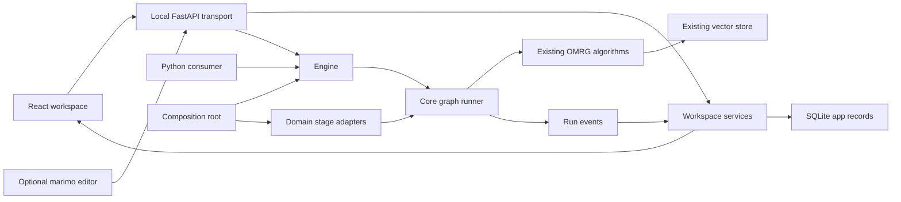

# Design: Local web pipeline workspace

## Context

See `proposal.md` for motivation and agreed scope. This is a planning document; no runtime capability described below has been implemented by this proposal.

### Required starting point

Apply this change only after `repair-modular-core-boundaries` has been implemented, verified, and integrated into the intended base checkout. Check the tested repair commit and focused regression evidence on that base. An archived change or checked tasks alone do not prove readiness.

The prerequisite owns registered sentence dispatch, metadata/codebase dependency forwarding, shared cache/map model imports, and safe cache context. This plan reuses those repaired seams. Per-source orchestration extraction remains in this change.

The codebase map has no Engine method. Its core API is `get_codebase_map_text(path, refresh, *, settings=None, store=None)` and `build_codebase_map(path, *, settings, store=None)`. The MCP tool is the only production caller; it resolves the process-default settings and store at its transport boundary. The web job service must not copy that pattern. It passes the owning Engine's settings and store explicitly. Map document communities always read the fixed `documents` collection. Cache reuse needs a matching Git commit and an owner context built from the map settings plus the store's durable `get_data_version("documents")`. On Chroma, or before a `documents` collection exists, no durable version exists, so the map skips the cache and rebuilds on each call. Choosing another collection for the map is out of scope.

### Observed foundations

| Evidence | Consequence for this design |
|---|---|
| `src/omrg/engine.py:118-251` | Ingestion and answering are async; search is synchronous. Keep their signatures and return shapes. |
| `src/omrg/compose_engine.py:48-195` | Composition owns providers, store, reranker, profiles, and OCR routes. Build resources here. |
| `src/omrg/core/retrieval/registry.py:60-64` | Existing functions and classes have different signatures. Graph adapters need a shared contract. |
| `src/omrg/core/retrieval/pipeline.py:136-441` | Candidate sizing, policy, threshold filtering, and fallback are orchestration-owned. Extract shared operations carefully. |
| `src/omrg/core/ingestion/chunker.py` | Reading, normalisation, enrichment, and splitting need separable boundaries. Preserve reader declarations and specialised dispatch. |
| `src/omrg/core/ingestion/replacement.py` | Replacement already protects write, verification, and stale cleanup. Keep this transaction-sized operation indivisible. |
| `src/omrg/core/profiles/resolver.py` | Environment snapshots beat profile values; explicit operation controls beat resolved defaults. |
| `src/omrg/core/ingestion/source_state.py` | Source identity and completeness guard reuse. Graph ingestion must retain these checks. |
| `src/omrg/transports/api/{README.md,openapi.yaml}` | HTTP has a contract but no runtime. Replace that temporary restriction in the delta specs. |
| `pyproject.toml` | Python 3.11+, Hatchling, npm for the proposed frontend, existing Pydantic and NetworkX dependencies. |
| `tests/test_engine.py:513` | The exact public Engine method set is tested. Update its expectation deliberately. |

Some baseline prose predates current code. The public API spec promises unspecified result/error exports, while `__all__` contains three names. The new API delta names the graph types explicitly. The architecture spec's top-level module list omits the current Engine and composition helpers; its affected requirement is corrected in this change. Legacy automatic repair described in `async-ingestion` disagrees with current pre-lineage rejection. This change preserves the tested rejection and does not introduce legacy repair or alter historical experiment evidence.

## Goals / Non-Goals

**Goals**

- User connections determine execution, with type-compatible branching and joining.
- Browser, notebooks, and library consumers share OMRG operations and resource ownership.
- Existing algorithms have one implementation, including policy, score handling, citations, and source replacement.
- Saved runs identify their graph, settings, inputs, index, and stage outcomes.
- A local installation works without a frontend development server or notebook plugin.

**Non-Goals**

- Distributed execution, accounts, remote exposure, collaboration, or a workflow platform.
- Feedback loops, arbitrary Python canvas nodes, a plugin marketplace, or an installer/updater UI.
- Provider/model switching inside one Engine, hidden re-indexing, or changes to RAG defaults.
- Automatic optimisation or unused extension points dedicated to it.
- An embedded editable marimo interface in the initial release.

## Decisions

### D1. Optional web transport over the existing framework

Use FastAPI for a thin HTTP layer and React Flow for the canvas. SQLite stores app records. Keep all RAG algorithms and graph execution under `core/`.

The agreed stack fits existing Pydantic models and Engine ownership. Django's ORM and admin were considered; these are useful for a larger database-driven application. They add little to the first local workspace. A standalone workflow framework was considered and excluded: the first runner needs finite typed graphs, bounded scheduling, and existing OMRG operations.

### D2. Small, versioned graph documents and a typed catalogue

A graph document contains a schema version, nodes, named input/output ports, edges, graph inputs/outputs, an optional operational profile, and allowed parameters. Store title, node positions, viewport, and selection separately. Layout changes do not create execution revisions.

The catalogue describes each operation's version, parameter schema, port types/cardinality, capabilities, effect class, bypass behaviour, and adapter reference. Domain adapters use existing strategy registries. Adding an operation requires one adapter and one registration; dispatch does not gain name-specific branches.

First-release operation families:

| Family | Reused operation boundary |
|---|---|
| Sources | Existing eligible-file discovery, canonical source identity, compatibility and complete-source checks. |
| Read | `read_document` and existing reader/OCR factories; retain `BackendRead` declarations. |
| Prepare text | Existing normalisation, metadata extraction, and content-type-aware splitting. |
| Embed / commit | Shared embedding preparation, then existing protected source replacement. |
| Retrieve | Query preparation, dense retrieval, sparse dispatch, candidate sizing, and policy. |
| Combine / select | Existing RRF, score-kind-aware filtering, top-k selection, and reranker fallback. |
| Context | Existing lineage expansion, overlap removal, and context assembly. |
| Answer / verify | Shared evidence preparation, synthesis, citation resolution, and opt-in claim verification. |

Ports carry source and collection provenance, score kinds, embedding identity, and reader declarations where applicable. A generic list of strings is insufficient for these contracts. Preview data contains bounded text samples and references; full vectors are not exposed to the canvas.

A disabled node is allowed only when its descriptor defines a compatible bypass. Reranking can pass ranked evidence through. An embedding node cannot pass raw text into a vector-only port.

### D3. Validate before admission; schedule finite graphs

Reject unknown operations, unsupported schema versions, invalid parameters, missing inputs, ambiguous multi-input wiring, cycles, incompatible ports/resources, and conflicting writes before launching a run. The browser uses the same published catalogue for early feedback; server validation is authoritative.

Use existing NetworkX support for topology checks where useful. Keep runtime scheduling small: maintain ready nodes and dependency counts, dispatch through injected adapters, and enforce a conservative concurrency bound. Independent branches can execute concurrently when their resource leases permit it. Joins wait for all required ports and assemble inputs in declared port order, independent of completion order. Copy mutable payloads or expose immutable values on fan-out.

Ordinary node failure fails the affected execution unit and skips dependent nodes. A single-unit query run then fails. Directory ingestion retains existing per-file handling; its failed summary can include successful sibling commits. Existing domain fallbacks are explicit adapter outcomes, preserving behaviour such as sparse or reranker degradation. Empty result sets are valid data. They can join another branch; answering returns its existing no-evidence outcome without calling a model.

Process directory ingestion one source at a time using existing discovery and source guards. Apply the compiled ingestion graph to each eligible source; events include a source-unit identifier. Keep prior successful source commits in the summary when a later unit fails. Do not materialise a directory's complete chunk/vector corpus. The initial source recipes preserve existing per-file failure handling; fatal graph/configuration errors stop admission or execution.

### D4. Share algorithms without rewriting unrelated orchestration

Use the prerequisite's registered document dispatcher and explicit store/settings chain. Graph adapters pass `store` and `settings` explicitly, because omission silently falls back to seed metadata categories or process defaults. Add each new adapter module to the accessor guard's leaf list (`_GUARDED_LEAVES` in `tests/test_no_global_settings_reads.py`) with a behavioural test that poisons the default accessors. Keep its replacement-sentinel, captured-prompt, cache-context, and fresh-import tests as regressions. Extract policy, filtering, fallback, source preparation, and document-to-chunk operations only where adapters need them. Standard `search`, `ingest`, and `answer` paths continue using these same functions. Canonical graph templates reproduce the standard paths and have parity fixtures.

Existing wrappers may remain orchestration facades. Do not create a second implementation of ranking, threshold transforms, chunking, or replacement inside the graph runner. Do not force synchronous `search()` through a nested event loop. The new graph API is async and offloads blocking adapters deliberately.

Keep `core/pipelines/` independent of ingestion, retrieval, answering, providers, transports, and subprocess launch. Composition injects a catalogue and adapters. Domain adapters belong to their owning domain packages and receive resources/settings; they do not import sibling domain implementations.

### D5. Freeze configuration and preserve index safety

Resolve each referenced collection once at admission. An omitted graph profile inherits the collection's profile. An explicit `documents` or `codebase` graph profile uses the existing bundle resolver without changing collection metadata. `hybrid` remains a server selector, not an operational graph profile.

Precedence for graph-supported levers is: validated node override, validated graph-wide override, resolved operational profile/defaults. Profile resolution retains its captured environment priority. Existing explicit operation overrides remain authoritative. The inspector shows effective values and their source.

Only allow documented operation controls and existing index-shaping settings. Runtime capabilities, provider/model identity, secrets, storage locations, and file access grants remain host-owned. A graph cannot change `.env`, construct a different provider, or silently download a model. Incompatible collection/embedding identities fail preflight, including different models with equal dimensions.

Keep source lineage, complete-version checks, structural vector validation, and replacement locking. The graph cannot schedule raw vector-store writes that bypass them. Permit one source-commit destination per ingestion recipe initially; comparison branches remain read-only or end in separate explicitly selected collections.

Extend the existing index-shaping fingerprint with operation versions, parameters, and connections in the ingestion commit's ancestor slice. Compute it from descriptor/parameter/upstream-port hashes, excluding presentation IDs, layout, labels, tracing, and query-only stages. Standard ingestion and an equivalent canonical graph must produce the same shaping identity through a shared description. Version any identity-schema change and document one-off reprocessing on the next explicit ingest. Unchanged content and a matching complete identity still skip expensive work. A changed ingestion graph requires explicit execution to rebuild affected sources; saving it does not mutate vectors.

### D6. Engine owns resources; jobs borrow them

Add `Engine.validate_pipeline(...)` and async `Engine.run_pipeline(...)`. Export `PipelineDefinition`, `PipelineResult`, `PipelineEvent`, and `PipelineValidationError` lazily alongside the existing names. Validation errors occur before side effects; runtime failures produce a result with the failing node and completed effects.

Composition injects stage factories and resources. Runs borrow engine-owned store, embedder, reranker, OCR, and completion seams. Answer and judge resources stay lazy. Initially serialise access to mutable shared model diagnostics and unsafe caches; retain existing embedding limiters and write locks.

A direct `close()` during an active graph run fails clearly and leaves the Engine usable. Web shutdown stops admission, cancels queued work, requests cooperative cancellation, waits for active calls/commits, then closes owned resources. Cancellation stops further scheduling and checks before commit. Once write/verification/cleanup begins, let that operation finish. Report completed effects in cancelled/failed results.

Blocking inference may finish after cancellation is requested. A browser disconnect does not cancel a run. Forced server termination leaves unfinished records interrupted at the next start; it does not imply rollback or automatic retry. These guarantees require application tests, not framework assumptions.

### D7. One local consumer and a small application store

Use one Uvicorn process, reload disabled, and one supervised run consumer. Allow bounded branch execution within a run. Start with a maximum of 16 waiting jobs and two ready branches; model/store guards can reduce effective concurrency. Reject excess admission visibly. Do not add Redis, Celery, or multi-process model copies.

Application records use a separate SQLite file in the selected workspace. Vector data remains in its current store. Suggested tables:

| Table | Contents |
|---|---|
| `pipelines` | Identity, title, current revision and presentation layout. |
| `pipeline_revisions` | Immutable execution document, content hash and schema version. |
| `runs` | Status, graph revision, redacted settings/resource identities, inputs/references, times and result reference. |
| `run_events` | Per-run sequence, event kind, node/unit identifier, safe summary and timestamp. |
| `plugin_registrations` | Approved manifest/executable references and compatibility status. |

Keep schema upgrades versioned and confined to application records. Back up existing app records before a schema change. Protect the workspace and private artefacts with owner-only permissions where the platform supports them. No vector-store migration is part of web startup. Use the standard library SQLite adapter behind an injected repository interface; it exchanges plain data and stays an integration leaf.

Commit a run/node status update and its event in one SQLite transaction, then notify subscribers. This does not create a transaction across SQLite and the vector store. A crash between those stores produces an interrupted run requiring inspection through existing source completeness/recovery rules.

Stream events using server-sent events (SSE). Replay persisted events after the last acknowledged sequence and deduplicate in the browser. Polling is a fallback. Never sum overlapping stage durations into a total; record separate end-to-end wall time. Save output references and bounded private artefacts under the workspace, not unbounded event payloads or vector arrays.

Retain run summaries/events until explicit cleanup. Limit each active result preview to 100 rows and 4 KiB per text preview; full evidence is fetched through protected inspection routes. Workspace cleanup previews affected app artefacts and never removes vector data, source files, or experiment outputs.

### D8. Protected local HTTP and explicit file grants

Launch with `omrg web`; add optional workspace/port/root arguments. Default to `127.0.0.1`, choose an available port, and reject non-loopback binding in this release. CLI messages stay on stderr. The web command bypasses the CLI's legacy process-default installer and owns one Engine through application lifespan.

Serve the bundled frontend and API from one origin. Use a random per-launch bootstrap secret exchanged for an HttpOnly, SameSite=Strict session. Avoid query-string secrets in access logs; a browser-launch fragment can carry the bootstrap value. Check Host and Origin on browser requests. Notebook clients use revocable per-launch bearer credentials with graph/read/run permissions, excluding plugin administration and general file grants.

Paths are canonicalised against explicit CLI/operator-approved roots; source paths recovered from indexed metadata do not grant file access. Do not accept arbitrary server paths from the browser. Upload ordinary supported files into workspace-managed storage, with a 50 MiB per-file default limit and a preflight size/type check. Exclude archive extraction and URL ingestion from this change. Retain existing supported-extension and content-detection decisions.

Implement the current `/v1` contract, including answering and job polling, then add catalogue, graph validation/revisions, graph-run events/cancellation, source inspection, and plugin lifecycle routes. Ingestion and codebase-map jobs use the same local job service. HTTP routes do validation, delegation, and formatting only. OpenAPI keeps explicit nullable/profile-resolved defaults and the existing error envelope.

Deletion and collection-profile changes require preview and explicit confirmation. Bind confirmation to the action, selector, observed store validity token, and expiration; reject stale previews. Show weaker cross-process guarantees where a backend exposes only process-local validity. Source inspection serves text safely; render Markdown without executing raw HTML. Protect state-changing routes and stream endpoints with the same access policy.

### D9. Compact application and evidence-first canvas

Navigation: Canvas, Library, Search, Ask, Runs, Experiments, Settings. Keep the first release focused on these existing operations and their new graph/run views.

- Canvas has a searchable node catalogue, editable compatible connections, profile/collection selection, Save/Validate/Run/Cancel actions, and a right-hand inspector.
- Node controls use catalogue schemas. Reranking and hybrid retrieval expose inherit/on/off, with the effective value and policy outcome shown separately.
- Library lists sources, counts, metadata, and machine-local orphan status; offers upload/ingest and confirmed deletion/profile changes.
- Search/Ask call shared core paths; citations open stored chunk evidence with neighbour navigation. Verification labels retain their actual guarantee and skipped reason.
- Runs shows immutable snapshots, actual stage states, failures, committed sources, and trace replay labelled as replay.
- Settings initially shows workspace, runtime capabilities, file grants, themes, and plugin status. It does not edit `.env` or silently switch model composition.

Apply the OMMS design direction through shared semantic variables: warm neutral surfaces, compact system typography, restrained borders, tinted actions, and distinct selection. Retain source attribution if copying licensed material. Use existing skill references as design guidance, not as imports of OMMS-specific components or preference stores.

Include keyboard-accessible node/connection editing, readable status text, visible focus, reduced motion, responsive inspectors, and light/dark modes. Verify all views at 1280px, 768px, and 390px widths in both themes. Check touched controls at 320px and 200% zoom, with keyboard/focus checks at desktop width. Use synthetic sources, including Arabic prose with English identifiers, and desktop-browser viewport checks. Use logical layout properties and isolate technical text so later Arabic localisation does not require layout replacement. Full translation dictionaries are a separate scope; the initial UI uses British English.

Animation follows actual core events. It indicates an active stage/edge and does not claim per-token transport, measured throughput, or fabricated percentages. Changing layout or a toggle during execution affects the draft/next run, never the admitted snapshot.

### D10. Optional marimo manifest plugin with independent updates

Choose a separately distributed declarative external-tool manifest and a small host launcher. A companion Python entry-point package was considered: it needs installation into OMRG's environment for discovery and an additional publishing lifecycle. A pinned optional marimo extra was considered and rejected because it couples dependency resolution to OMRG.

Proposed plugin payload: `plugins/marimo/manifest.json`, documentation, and a starter notebook. Exclude this directory from the base wheel. A manifest contains schema/plugin versions, capability identifiers, a tested tool-version range, executable reference, and structured argument templates with a fixed set of substitutions. It contains no shell commands, Python import hooks, credentials, or installation actions. Registering/enabling it is an explicit trust decision.

The host validates templates and permits only its supported notebook launch/probe recipe. The external manifest supplies editor-specific arguments. The generic process adapter owns process creation and cleanup. No graph domain code imports marimo or uv.

Operators install and upgrade marimo outside OMRG, for example in a persistent isolated uv tool environment. The app detects and probes the registered executable; it never invokes `uvx`, installs dependencies, or upgrades packages when opening Experiments. Document stop/update/recheck/start rather than building an update UI.

Before launch, require a compatible version/capability probe and consent to open executable notebooks. Bind the editor to loopback with authentication. Disable startup cell execution, use lazy propagation, and disable automatic updates/package installation in the launch configuration. Supply secrets through supported transient mechanisms, never saved notebooks or logs. Confirm these settings against the qualified marimo version; documentation differs on defaults.

Open `marimo edit` in a separate browser tab. Track only owned process groups, stop them gracefully, and use bounded escalation after the user approves Stop or agreed app shutdown. Preserve notebook files. Do not adopt or kill an unrelated editor on a conflicting port.

The starter notebook calls the local graph API using ephemeral credentials and explicit execution controls. It records graph revision, effective settings, backend and index identity with its experiment outputs. For write experiments, the operator registers an experiment workspace below an approved experiment root. Composition constructs a separate Engine context with its store inside that workspace's `output/`; the job borrows that context and releases it after execution. Use LanceDB unless store choice is the declared factor. Notebook requests select an approved context identifier, not an arbitrary store URI or provider. Core admission rejects notebook writes targeting the live library through the experiment credential. Disclose that trusted Python still has the user's filesystem/network permissions; a dependency environment is not an operating-system sandbox.

Updating marimo normally requires no OMRG dependency change. An incompatible CLI/protocol change can require an updated manifest or host capability; unsupported versions stay disabled with an actionable message.

### D11. Package once; keep optional dependencies optional

Build the React/Vite frontend with npm during development/release preparation. Force-include built assets in the Hatchling wheel and fail release preparation if they are missing. End users need neither npm nor a separate Node server. Preserve frontend routes without letting the fallback swallow `/v1` errors.

FastAPI/Uvicorn are in the `web` extra. Lazy CLI registration permits `omrg --help`, imports, and existing commands without that extra. A missing extra produces an installation instruction only on `omrg web`. Qualify dependency floors against the lock and floor tests; marimo/uv stay outside the lock. Add frontend lint/type checks, Vitest, a focused browser smoke, wheel smoke tests, and import/torch-free checks.

Use focused parity/contract tests before broad validation. Tests must first fail with the new behaviour absent or broken. Full suites, installs, and model downloads retain their approval gates.

### D12. Later device-aware optimisation

A future change can offer **Quick**, **Standard**, and **Full**. It will detect CPU, memory, accelerators, available backends, and installed models, then test bounded candidates through the same graph API. The result should identify the best tested configuration for a declared objective and dataset, with uncertainty and trade-offs.

Quick can check capability/speed; Standard can compare a representative labelled subset; Full can run a broader confirmed evaluation. Exact budgets and gates need that later proposal. Hardware throughput cannot establish retrieval quality. Keep baseline, quality/latency/memory metrics, dataset and index identities, and checkpointed evidence. Require explicit approval before applying recommendations, downloading models, rebuilding indexes, or changing persistent settings.

The current `omrg benchmark` measures embedding throughput and reads legacy process-default state. It is evidence to inspect during the later change, not a ready optimiser to invoke from this app. Add no optimisation endpoint, button, dependency, telemetry collection, or unused tuning scaffolding now.

## Risks / Trade-offs

| Risk | Mitigation |
|---|---|
| Stage extraction changes ranking or citations. | Share existing algorithms; test canonical graphs against existing outputs and score kinds. |
| A graph bypasses source replacement or mixes identities. | Effect-aware preflight, protected commit adapter, same-model guard, and index-shaping fingerprints. |
| Blocking calls continue after cancellation. | Cooperative checkpoints, honest cancelling state, resource leases, and interruption reporting after forced exit. |
| Web and MCP processes write the same store. | One web worker; preserve existing locking; disclose process-local limits and qualify external-writer fixtures. |
| Events disagree with vector data after a crash. | Persist intent/status, keep atomic source commit, mark interruption, and inspect before explicit retry. |
| Local endpoints are reachable from an unrelated webpage. | Loopback binding, Host/Origin checks, session/bearer protection, and canonical path grants. |
| A notebook executes untrusted code or installs packages. | Explicit trust, disabled startup execution/install behaviour, separate environment, and documented permission limits. |
| Upstream marimo changes its CLI. | External manifest, tested range/probe, no automatic updates, and disabled incompatible launch. |
| Optional UI grows into a second configuration system. | Use profile resolution and per-run overrides; keep `.env`, providers, and vector data outside workspace mutation. |

## Migration Plan

1. Verify the integrated `repair-modular-core-boundaries` commit and regressions on the intended base; stop if the gate fails.
2. Implement and test the shared stage contracts and graph API before UI work.
3. Add the app repository and local run service without opening or migrating vector data.
4. Implement contract-conformant HTTP and packaged assets behind the optional web command.
5. Add the canvas and existing document workflows, then register the separate marimo payload.
6. Test source/index identity changes explicitly; opening the web app does not re-ingest sources.
7. Update the affected specs, guides, import contracts, and a proposed ADR during implementation.
8. Validate and obtain approval before any release or dependency installation.

Rollback stops the web server and plugin, then returns to existing MCP/CLI/library entry points. Keep app records and experiment artefacts. No automatic index rollback or deletion occurs. A new graph-shaped index identity can require an explicit re-ingest with the chosen previous settings; document this before enabling ingestion recipes.

## Qualification Gates

- Confirm the prerequisite repair is integrated and its named dispatch, taxonomy, cache-context, import-order, and accessor regressions pass on the intended base: `tests/test_document_registry_dispatch.py`, `tests/test_metadata_store_ownership.py`, `tests/unit/test_codebase_context_repair.py`, and `tests/test_no_global_settings_reads.py`. Compare the results with the archived evidence in `openspec/changes/archive/2026-10-13-repair-modular-core-boundaries/evidence/`. Reconcile overlapping deltas against that repaired baseline before archiving this web change.
- Confirm marimo/uv compatibility and startup-execution controls on the selected versions before enabling the plugin.
- Verify model/backend concurrency; serial access remains the safe default until that test passes.
- Prove optional install floors, packaged assets, and the torch-free base/web dependency sets.
- Resolve affected baseline conflicts through the supplied deltas; do not weaken lineage rejection to match old prose.

These gates validate the chosen design. They do not authorise automatic installation, cloud use, or changes to the agreed scope.

## References

- React Flow: [custom nodes](https://reactflow.dev/learn/customization/custom-nodes), [connection validation](https://reactflow.dev/examples/interaction/validation), [cycle prevention](https://reactflow.dev/examples/interaction/prevent-cycles), [accessibility](https://reactflow.dev/learn/advanced-use/accessibility).
- FastAPI: [lifespan](https://fastapi.tiangolo.com/advanced/events/), [static files](https://fastapi.tiangolo.com/tutorial/static-files/), [background-task caveats](https://fastapi.tiangolo.com/tutorial/background-tasks/).
- Packaging: [Hatch build inclusion](https://hatch.pypa.io/1.16/config/build/), [Vite production build](https://vite.dev/guide/build), [optional dependencies](https://packaging.python.org/en/latest/guides/writing-pyproject-toml/).
- marimo: [CLI](https://docs.marimo.io/cli), [configuration](https://docs.marimo.io/guides/configuration), [expensive notebooks](https://docs.marimo.io/guides/expensive_notebooks/), [security](https://docs.marimo.io/security).
- Independent tools: [uv tool environments](https://docs.astral.sh/uv/concepts/tools/), [Python entry-point discovery](https://docs.python.org/3/library/importlib.metadata.html).
- Local persistence: [SQLite atomic commit](https://sqlite.org/atomiccommit.html).
- Visual direction: OMMS design skill foundations, components, localisation and verification references. Record the OpenChamber attribution when material is copied.

Official pages were checked through Tavily after repeated Context7 quota failures and unavailable Ref tools. Installed-version and runtime claims remain qualification tests; no benchmarks, installs, or experiments were run while planning.
